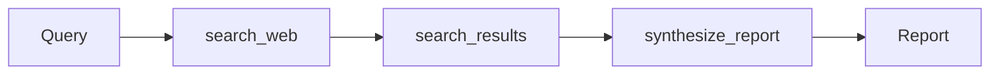

## Why LangGraph?

CrewAI is great for **role-based crews**. LangGraph shines when the flow is a **state machine** — when each step transforms an explicit state object and the next step sees that state. This makes it easier to:

- Add retries and fallbacks.
- Branch on intermediate results.
- Replay or fork executions.
- Stream partial results.

## The minimal graph

```python title="agent.py"
from typing import Annotated, TypedDict
from langchain_core.messages import AIMessage, HumanMessage, SystemMessage
from langchain_openai import ChatOpenAI
from langchain_tavily import TavilySearch
from langgraph.graph import END, StateGraph
from langgraph.graph.message import add_messages


class ResearchState(TypedDict):
    messages: Annotated[list, add_messages]
    query: str
    search_results: list[dict]
    report: str


def search_web(state: ResearchState) -> ResearchState:
    tool = TavilySearch(max_results=5)
    raw = tool.invoke(state["query"])
    results = raw.get("results", []) if isinstance(raw, dict) else raw
    return {"search_results": results}


def synthesize_report(state: ResearchState) -> ResearchState:
    llm = ChatOpenAI(model="gpt-4o-mini", temperature=0)
    text = "\n\n".join(
        f"Source: {r.get('url')}\nTitle: {r.get('title')}\nContent: {r.get('content', '')[:500]}"
        for r in state["search_results"]
    )
    msgs = [
        SystemMessage(content="You are a research analyst. Synthesise search results into Summary, Key Findings, Sources."),
        HumanMessage(content=f"Query: {state['query']}\n\nResults:\n{text}"),
    ]
    response = llm.invoke(msgs)
    return {"report": response.content, "messages": [response]}


def build_graph() -> StateGraph:
    graph = StateGraph(ResearchState)
    graph.add_node("search", search_web)
    graph.add_node("synthesize", synthesize_report)
    graph.set_entry_point("search")
    graph.add_edge("search", "synthesize")
    graph.add_edge("synthesize", END)
    return graph.compile()


if __name__ == "__main__":
    agent = build_graph()
    result = agent.invoke({"query": "latest advances in AI agents 2024", "messages": [], "search_results": [], "report": ""})
    print(result["report"])
```

## Run it

```bash
pip install -r requirements.txt
export OPENAI_API_KEY=...
export TAVILY_API_KEY=...
python agent.py --query "what changed in AI agent frameworks in 2025"
```

## Anatomy of the graph



Each node takes the current `ResearchState` and returns a partial update; LangGraph merges it back into the state. The `Annotated[list, add_messages]` reducer deduplicates `messages` so the graph stays idempotent.

## Why state, not messages alone?

Using a typed `TypedDict` lets you name fields (`query`, `search_results`, `report`) and let each node operate on a small surface. Compare to passing a `messages` blob — every node has to grovel through the same conversation history.

## Try extending

- Add a third node `critique_report` that reviews the report and returns to `synthesize_report` with feedback.
- Add a `confidence` field on `ResearchState`; route low-confidence cases back to `search_web` with a refined query.
- Swap `TavilySearch` for your private search backend.

The full pattern is the **ReAct loop**: search → answer → critique → search again.