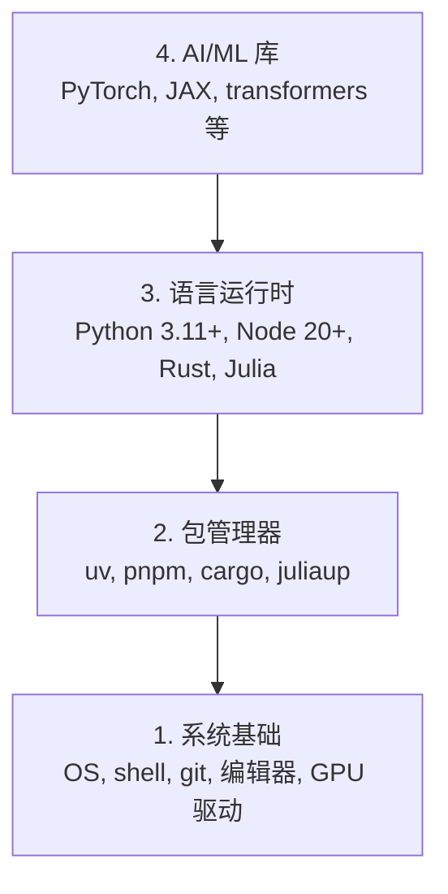

# 开发环境

> 工具塑造思维。一次装对，长期省心。

**类型:** Build
**语言:** Python, Node.js, Rust
**先修:** 无
**时长:** ~45 分钟

## 学习目标

- 从零配置 Python 3.11+、Node.js 20+ 与 Rust 工具链
- 配置虚拟环境与包管理器，保证可复现构建
- 验证 GPU（CUDA/MPS）并跑通一次测试张量运算
- 理解四层栈：系统、包管理器、语言运行时、AI 库

## 问题

你将用 Python、TypeScript、Rust 和 Julia 学完 500+ 课 AI 工程。环境若不稳，每一课都会变成和工具链搏斗，而不是在学 AI。

大多数人跳过环境配置，然后花几小时调试 import 错误、版本冲突和缺失的 CUDA 驱动。我们一次做对。

## 概念

AI 工程环境有四层：



自底向上安装。每层依赖下面一层。

```figure
s0-env-stack
```

## 动手做

### 步骤 1：系统基础

检查系统并安装基础工具。

```bash
# macOS
xcode-select --install
brew install git curl wget

# Ubuntu/Debian
sudo apt update && sudo apt install -y build-essential git curl wget unzip

# Windows（使用 WSL2）
wsl --install -d Ubuntu-24.04
```

### 步骤 2：用 uv 装 Python

使用 `uv` —— 比 pip 快 10–100 倍，并自动处理虚拟环境。

```bash
curl -LsSf https://astral.sh/uv/install.sh | sh

uv python install 3.12

uv venv
source .venv/bin/activate  # Windows 为 .venv\Scripts\activate

uv pip install numpy matplotlib jupyter
```

验证：

```python
import sys
print(f"Python {sys.version}")

import numpy as np
print(f"NumPy {np.__version__}")
a = np.array([1, 2, 3])
print(f"Vector: {a}, dot product with itself: {np.dot(a, a)}")
```

### 步骤 3：Node.js 与 pnpm

用于 TypeScript 课程（Agent、MCP 服务、Web 应用）。

```bash
curl -fsSL https://fnm.vercel.app/install | bash
fnm install 22
fnm use 22

npm install -g pnpm

node -e "console.log('Node', process.version)"
```

fnm 安装器会先检查 `unzip`；缺失时会退出并提示 `Not installing fnm due to missing dependencies.`：Linux 上用于解压 zip，macOS 上经 Homebrew 安装。macOS 自带 `unzip`；Ubuntu / Debian / WSL2 可用步骤 1 的 apt 行（若跳过了请执行 `sudo apt install -y unzip`）。

**macOS / Apple Silicon (M1/M2/M3/M4)：** 若安装器报 `Error: Cannot install under Rosetta 2 in ARM default prefix (/opt/homebrew)`，说明终端跑在 Rosetta 2 下（`arch` 显示 `i386`），而 Homebrew 是原生 arm64。强制 arm64 安装 fnm，写入 shell 后再从 `fnm install 22` 继续：

```bash
arch -arm64 brew install fnm
echo 'eval "$(fnm env --use-on-cd)"' >> ~/.zshrc
source ~/.zshrc
```

### 步骤 4：Rust

用于性能关键课程（推理、系统）。

```bash
curl --proto '=https' --tlsv1.2 -sSf https://sh.rustup.rs | sh

rustc --version
cargo --version
```

### 步骤 5：Julia（可选）

适合数学密集、Julia 更顺手的课程。

```bash
curl -fsSL https://install.julialang.org | sh

julia -e 'println("Julia ", VERSION)'
```

### 步骤 6：GPU（若有）

**NVIDIA（Linux / Windows）：**

```bash
nvidia-smi

# 安装带 CUDA 的 PyTorch
uv pip install torch torchvision torchaudio --index-url https://download.pytorch.org/whl/cu124
```

**macOS / Apple Silicon：** Mac 没有 CUDA —— 这是预期行为。**不要**传 `--index-url .../cuXXX`（那些 wheel 仅限 Linux/Windows）。安装普通构建即可，含 Apple MPS（Metal）GPU 后端：

```bash
uv pip install torch torchvision torchaudio
```

验证（各平台通用）：

```python
import torch
print(f"CUDA available: {torch.cuda.is_available()}")           # macOS 上为 False —— 正常
print(f"MPS available:  {torch.backends.mps.is_available()}")   # Apple Silicon 上为 True
if torch.cuda.is_available():
    print(f"GPU: {torch.cuda.get_device_name(0)}")
```

没有 GPU？没问题。多数课可在 CPU 上完成。训练密集课可用 Google Colab 或云 GPU。

### 步骤 7：验证你要走的路线

在**仓库根目录**（含 `README.md` 与 `phases/`）执行本课命令。预检只检查所选路线所需项，默认跳过后期工具，让新手看到一条清晰答案而不是满屏警告。

启动完整新手序列：

```bash
python3 phases/00-setup-and-tooling/01-dev-environment/code/verify.py --route beginner
```

或只检查某条路线：

```bash
python3 phases/00-setup-and-tooling/01-dev-environment/code/verify.py --route ml-foundations
python3 phases/00-setup-and-tooling/01-dev-environment/code/verify.py --route llm-engineering
python3 phases/00-setup-and-tooling/01-dev-environment/code/verify.py --route agents
python3 phases/00-setup-and-tooling/01-dev-environment/code/verify.py --route mcp
python3 phases/00-setup-and-tooling/01-dev-environment/code/verify.py --route agent-skills
python3 phases/00-setup-and-tooling/01-dev-environment/code/verify.py --route certification
```

需要一并检查后期可选工具时加 `--show-later`。缺少后期工具**不会**阻塞当前路线。

每项失败的必检项会给出检测到的路径或 import 错误，以及精确的修复命令。Agent Skills 与认证路线还会显示人工宿主检查，因为 Python 脚本无法证明 AI 宿主已发现 skill 或你的 skill 作用域可写。

新手预检通过后会打印第一门可运行课：

```text
Ready to start Beginner course.
Next: python3 phases/01-math-foundations/01-linear-algebra-intuition/code/vectors.py
```

## 用起来

环境已就绪，可按你检查的路线开课。后期工具在课程要求时再装，不要被整栈挡住第一课。课程中会用到：

| 语言 | 用于 | 包管理器 |
|------|------|----------|
| Python | 阶段 1–12（ML、DL、NLP、视觉、音频、LLM） | uv |
| TypeScript | 阶段 13–17（工具、Agent、集群、基础设施） | pnpm |
| Rust | 阶段 12、15–17（性能关键系统） | cargo |
| Julia | 阶段 1（数学基础） | Pkg |

## 交付

本课产出一个任何人都能运行的环境验证脚本。

见 `outputs/prompt-env-check.md`：用于让 AI 助手诊断环境问题的提示词。

## 练习

1. 运行验证脚本并修复所有失败项
2. 为本课程创建 Python 虚拟环境并安装 PyTorch
3. 用四种语言各写一个 hello world 并运行
