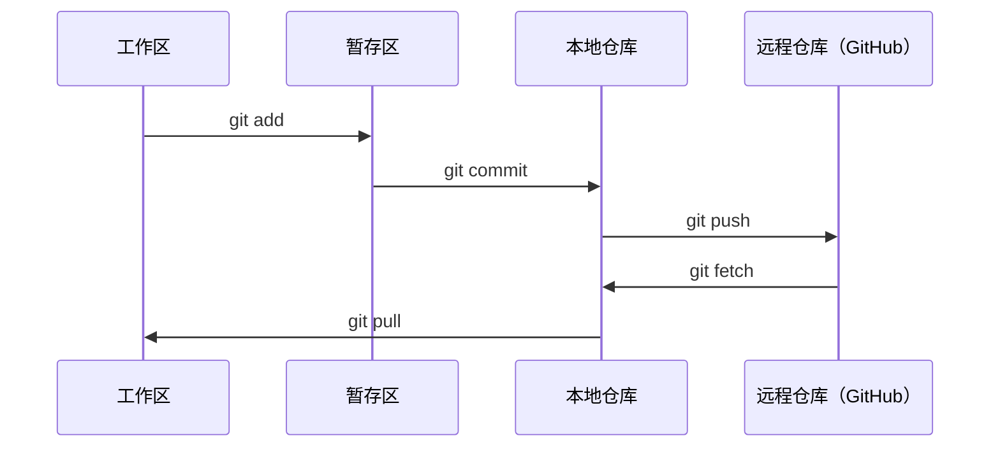

# Git 与协作

> 版本控制不是可选项。这里的每一个实验、每一个模型、每一课，都要被记录下来。

**类型:** Learn
**语言:** --
**先修:** 阶段 0、第 01 课
**时长:** ~30 分钟

## 学习目标

- 配置 Git 身份，并掌握 add、commit、push 的日常流程
- 创建和合并分支，在不影响 main 的前提下做隔离实验
- 编写 `.gitignore`，排除模型检查点和大型二进制文件
- 用 `git log` 浏览提交历史，理解项目演进

## 问题

接下来的 20 个阶段里，你会写上百个代码文件。没有版本控制，你会丢掉成果、弄坏无法撤销的东西，也没法和别人协作。

Git 是工具，GitHub 是代码的存放地。本课只讲这门课需要的部分，不多不少。

## 概念



记住三件事：
1. 经常保存（`git commit`）
2. 推送到远程（`git push`）
3. 用分支做实验（`git checkout -b experiment`）

```figure
s0-commit-dag
```

## 动手做

### 步骤 1：配置 Git

```bash
git config --global user.name "Your Name"
git config --global user.email "you@example.com"
```

### 步骤 2：日常工作流

```bash
git status
git add file.py
git commit -m "Add perceptron implementation"
git push origin main
```

### 步骤 3：用分支做实验

```bash
git checkout -b experiment/new-optimizer

# ... make changes, commit ...

git checkout main
git merge experiment/new-optimizer
```

### 步骤 4：使用本课程仓库

你无法直接推送到课程仓库——只有维护者有写权限。先在 GitHub 上 Fork（右上角的 Fork 按钮），让 `origin` 指向你自己的副本：

```bash
git clone https://github.com/YOUR-USERNAME/ai-engineering-from-scratch.git
cd ai-engineering-from-scratch

git checkout -b my-progress
# work through lessons, commit your code
git push origin my-progress
```

## 用起来

这门课只需要这几条命令：

| 命令 | 何时用 |
|---------|------|
| `git clone` | 获取课程仓库 |
| `git add` + `git commit` | 保存你的成果 |
| `git push` | 备份到 GitHub |
| `git checkout -b` | 尝试新东西而不弄坏 main |
| `git log --oneline` | 看看你做了什么 |

就这样。这门课不需要 rebase、cherry-pick 或 submodule。

## 练习

1. Fork 本仓库，克隆你的 fork，创建名为 `my-progress` 的分支，新建一个文件，提交并推送
2. 编写一个 `.gitignore`，排除模型检查点文件（`.pt`、`.pth`、`.safetensors`）
3. 用 `git log --oneline` 查看本仓库的提交历史，了解课程是如何逐步加入的

## 关键术语

| 术语 | 人们常说 | 实际含义 |
|------|----------------|----------------------|
| Commit | “保存” | 项目在某一时刻的完整快照 |
| Branch | “一个副本” | 指向某个 commit 的指针，随你的工作向前移动 |
| Merge | “合并代码” | 把一个分支上的变更应用到另一个分支 |
| Remote | “云端” | 托管在别处的仓库副本（GitHub、GitLab） |
