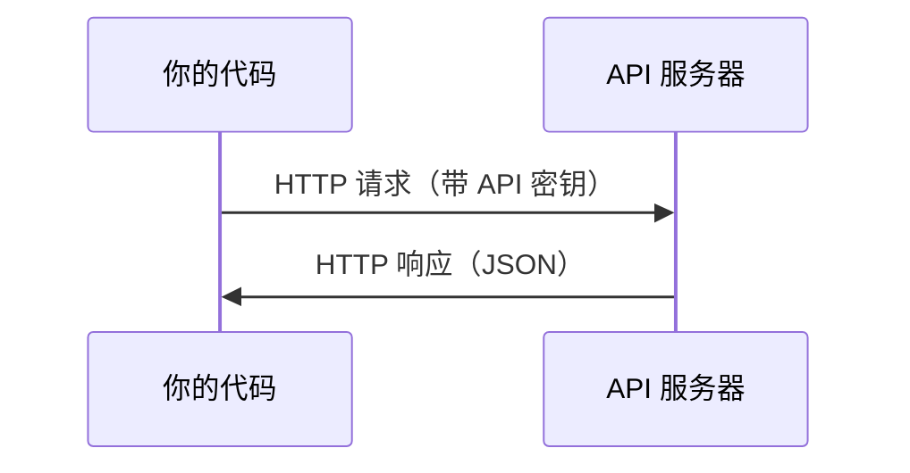

# API 与密钥

> 每个 AI API 的工作方式都一样：发请求，收响应。细节会变，模式不变。

**类型:** Build
**语言:** Python, TypeScript
**先修:** 阶段 0、第 01 课
**时长:** ~30 分钟

## 学习目标

- 用环境变量和 `.env` 文件安全地保存 API 密钥
- 分别用 Anthropic Python SDK 和原生 HTTP 调用 LLM API
- 对比 SDK 与原生 HTTP 的请求/响应格式，便于调试
- 识别并处理常见 API 错误，包括认证失败和速率限制

## 问题

从阶段 11 开始，你会调用 LLM API（Anthropic、OpenAI、Google）。在阶段 13–16，你会构建在循环中使用这些 API 的 Agent。你需要知道 API 密钥如何工作、如何安全保存，以及如何发出第一次 API 调用。

## 概念



每次 API 调用都包含：
1. 一个端点（URL）
2. 一个 API 密钥（认证）
3. 一个请求体（你要什么）
4. 一个响应体（你拿到什么）

```figure
s0-secret-inject
```

## 动手做

### 步骤 1：安全保存 API 密钥

永远不要把 API 密钥写进代码。使用环境变量。

```bash
export ANTHROPIC_API_KEY="sk-ant-..."
export OPENAI_API_KEY="sk-..."
```

或者用 `.env` 文件（记得加进 `.gitignore`）：

```
ANTHROPIC_API_KEY=sk-ant-...
OPENAI_API_KEY=sk-...
```

### 步骤 2：第一次 API 调用（Python）

```python
import os

import anthropic

client = anthropic.Anthropic()

MODEL = os.environ.get("LLM_MODEL", "claude-sonnet-5")

response = client.messages.create(
    model=MODEL,
    max_tokens=256,
    messages=[{"role": "user", "content": "What is a neural network in one sentence?"}]
)

print(response.content[0].text)
```

`LLM_MODEL` 用来选择 Anthropic 模型 id，默认是不带日期的 Sonnet 别名。其他提供商（OpenAI、Google 等）也是同样的模式：一个密钥加一个模型 id，但各自有自己的 SDK、端点和请求/响应 schema。

### 步骤 3：第一次 API 调用（TypeScript）

```typescript
import Anthropic from "@anthropic-ai/sdk";

const client = new Anthropic();

const MODEL = process.env.LLM_MODEL ?? "claude-sonnet-5";

const response = await client.messages.create({
  model: MODEL,
  max_tokens: 256,
  messages: [{ role: "user", content: "What is a neural network in one sentence?" }],
});

console.log(response.content[0].text);
```

### 步骤 4：原生 HTTP（不用 SDK）

```python
import os
import urllib.request
import json

url = "https://api.anthropic.com/v1/messages"
headers = {
    "Content-Type": "application/json",
    "x-api-key": os.environ["ANTHROPIC_API_KEY"],
    "anthropic-version": "2023-06-01",
}
body = json.dumps({
    "model": os.environ.get("LLM_MODEL", "claude-sonnet-5"),
    "max_tokens": 256,
    "messages": [{"role": "user", "content": "What is a neural network in one sentence?"}],
}).encode()

req = urllib.request.Request(url, data=body, headers=headers, method="POST")
with urllib.request.urlopen(req) as resp:
    result = json.loads(resp.read())
    print(result["content"][0]["text"])
```

这就是 SDK 底层在做的事。理解原生 HTTP 调用，调试时会很有用。

## 用起来

这门课会用到：

| API | 何时需要 | 免费额度 |
|-----|-----------------|-----------|
| Anthropic (Claude) | 阶段 11–16（Agent、工具） | 注册送 $5 额度 |
| OpenAI | 阶段 11（对比） | 注册送 $5 额度 |
| Hugging Face | 阶段 4–10（模型、数据集） | 免费 |

你现在不需要全部开通。课程用到时再配置。

## 交付

本课产出：
- `outputs/prompt-api-troubleshooter.md` —— 诊断常见 API 错误

## 练习

1. 获取 Anthropic API 密钥，发出你的第一次 API 调用
2. 试一遍原生 HTTP 版本，对比响应格式与 SDK 版本有何不同
3. 故意用错误的 API 密钥，读一读错误信息

## 关键术语

| 术语 | 人们常说 | 实际含义 |
|------|----------------|----------------------|
| API key | “API 的密码” | 标识你账户并授权请求的唯一字符串 |
| Rate limit | “他们在限流我” | 每分钟/每小时的最大请求数，防止滥用并保证公平使用 |
| Token | “一个词”（API 语境下） | 计费单位：输入和输出 token 分别计数、分别计费 |
| Streaming | “实时响应” | 逐词获取响应，而不是等完整响应返回 |
