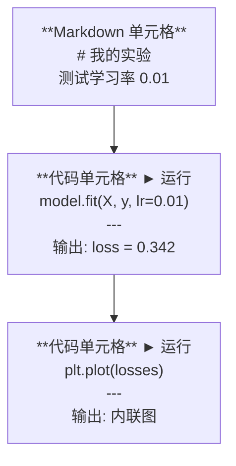
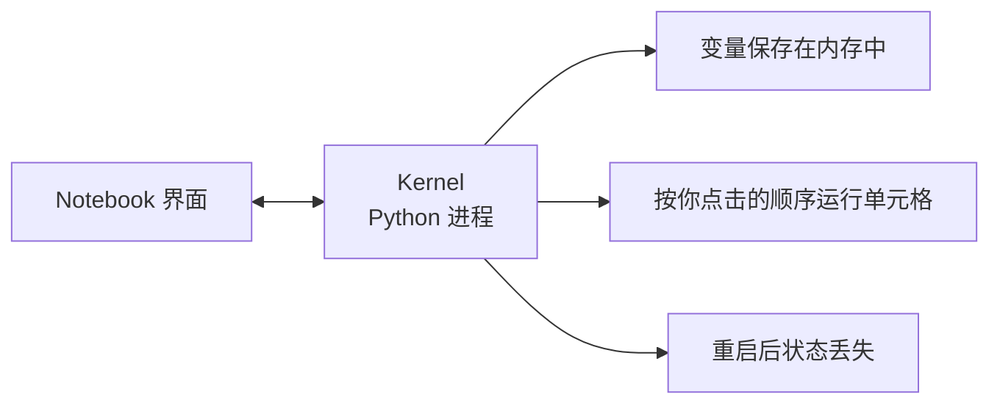

# Jupyter Notebook

> Notebook 是 AI 工程的实验台。你在这里做原型，再把跑通的东西搬进生产。

**类型:** Build
**语言:** Python
**先修:** 阶段 0、第 01 课
**时长:** ~30 分钟

## 学习目标

- 安装并启动 JupyterLab、Jupyter Notebook，或带 Jupyter 扩展的 VS Code
- 使用 magic 命令（`%timeit`、`%%time`、`%matplotlib inline`）做内联计时和可视化
- 区分何时用 notebook、何时用脚本，应用“在 notebook 里探索，用脚本交付”的工作流
- 识别并避开 notebook 的常见陷阱：乱序执行、隐藏状态、内存泄漏

## 问题

每一篇 AI 论文、教程和 Kaggle 比赛都在用 Jupyter notebook。它让你分块跑代码、内联看输出、把代码和说明混在一起、快速迭代。不用 notebook 学 AI，就像做数学作业没有草稿纸。

但 notebook 也有真实的坑。人们什么都往里塞，包括它根本不擅长的事。知道何时用 notebook、何时用脚本，能让你以后少掉进调试噩梦。

## 概念

Notebook 是一串单元格（cell）。每个单元格要么是代码，要么是文本。



Kernel（内核）是在后台运行的 Python 进程。你运行一个单元格时，代码被发给 kernel 执行，结果再传回来。所有单元格共享同一个 kernel，所以变量在单元格之间会保留。



“按你点击的顺序运行”这一点，既是超能力，也是自砸脚的坑。

```figure
s0-cell-order
```

## 动手做

### 步骤 1：选一个界面

三个选项，一种格式：

| 界面 | 安装 | 适合 |
|-----------|---------|----------|
| JupyterLab | `pip install jupyterlab` 然后 `jupyter lab` | 完整 IDE 体验：多标签、文件浏览器、终端 |
| Jupyter Notebook | `pip install notebook` 然后 `jupyter notebook` | 简单轻量，一次一个 notebook |
| VS Code | 安装 “Jupyter” 扩展 | 已在编辑器里，git 集成、调试 |

三者读写同一种 `.ipynb` 文件。喜欢哪个用哪个。AI 工作中最常见的是 JupyterLab。

```bash
pip install jupyterlab
jupyter lab
```

### 步骤 2：重要的键盘快捷键

你有两种模式。按 `Escape` 进入命令模式（左侧蓝色条），按 `Enter` 进入编辑模式（绿色条）。

**命令模式（最常用）：**

| 按键 | 作用 |
|-----|--------|
| `Shift+Enter` | 运行单元格，跳到下一个 |
| `A` | 在上方插入单元格 |
| `B` | 在下方插入单元格 |
| `DD` | 删除单元格 |
| `M` | 转为 markdown |
| `Y` | 转为代码 |
| `Z` | 撤销单元格操作 |
| `Ctrl+Shift+H` | 显示全部快捷键 |

**编辑模式：**

| 按键 | 作用 |
|-----|--------|
| `Tab` | 自动补全 |
| `Shift+Tab` | 显示函数签名 |
| `Ctrl+/` | 切换注释 |

`Shift+Enter` 是你一天会按上千次的那个。先把它练熟。

### 步骤 3：单元格类型

**代码单元格**运行 Python 并显示输出：

```python
import numpy as np
data = np.random.randn(1000)
data.mean(), data.std()
```

输出：`(0.0032, 0.9987)`

**Markdown 单元格**渲染格式化文本。用它们记录你在做什么、为什么做。支持标题、粗体、斜体、LaTeX 公式（`$E = mc^2$`）、表格和图片。

### 步骤 4：Magic 命令

这些不是 Python。它们是 Jupyter 专属命令，以 `%`（行 magic）或 `%%`（单元格 magic）开头。

**给代码计时：**

```python
%timeit np.random.randn(10000)
```

输出：`45.2 us +/- 1.3 us per loop`

```python
%%time
model.fit(X_train, y_train, epochs=10)
```

输出：`Wall time: 2.34 s`

`%timeit` 会跑很多次取平均，`%%time` 只跑一次。微基准用 `%timeit`，训练跑用 `%%time`。

**启用内联绘图：**

```python
%matplotlib inline
```

之后每个 `plt.plot()` 或 `plt.show()` 都会直接渲染在 notebook 里。

**不离开 notebook 安装包：**

```python
!pip install scikit-learn
```

`!` 前缀可以跑任意 shell 命令。

**查看环境变量：**

```python
%env CUDA_VISIBLE_DEVICES
```

### 步骤 5：内联展示富输出

Notebook 会自动显示单元格里最后一个表达式。但你可以控制它：

```python
import pandas as pd

df = pd.DataFrame({
    "model": ["Linear", "Random Forest", "Neural Net"],
    "accuracy": [0.72, 0.89, 0.94],
    "training_time": [0.1, 2.3, 45.6]
})
df
```

这会渲染成格式化的 HTML 表格，而不是文本转储。图也一样：

```python
import matplotlib.pyplot as plt

plt.figure(figsize=(8, 4))
plt.plot([1, 2, 3, 4], [1, 4, 2, 3])
plt.title("Inline Plot")
plt.show()
```

图会出现在单元格正下方。这就是 notebook 主导 AI 工作的原因：数据、图和代码在一起。

图片：

```python
from IPython.display import Image, display
display(Image(filename="architecture.png"))
```

### 步骤 6：Google Colab

Colab 是云端的免费 Jupyter notebook。它提供 GPU、预装库和 Google Drive 集成，无需任何配置。

1. 打开 [colab.research.google.com](https://colab.research.google.com)
2. 上传本课程的任意 `.ipynb` 文件
3. Runtime > Change runtime type > T4 GPU（免费）

Colab 与本地 Jupyter 的差异：
- 文件在会话之间不保留（存到 Drive 或下载）
- 预装：numpy、pandas、matplotlib、torch、tensorflow、sklearn
- `from google.colab import files` 上传/下载文件
- `from google.colab import drive; drive.mount('/content/drive')` 持久化存储
- 空闲 90 分钟后会话超时（免费层）

## 用起来

### Notebook vs 脚本：何时用哪个

| 用 notebook | 用脚本 |
|-------------------|-----------------|
| 探索数据集 | 训练流水线 |
| 原型验证模型 | 可复用工具 |
| 可视化结果 | 任何带 `if __name__` 的代码 |
| 解释你的工作 | 按计划定时运行的代码 |
| 快速实验 | 生产代码 |
| 课程练习 | 包和库 |

原则：**在 notebook 里探索，用脚本交付**。

AI 中常见的工作流：
1. 在 notebook 里探索数据
2. 在 notebook 里做模型原型
3. 跑通后，把代码挪到 `.py` 文件
4. 再把这些 `.py` 文件 import 回 notebook 做进一步实验

### 常见陷阱

**乱序执行。** 你先跑单元格 5，再跑 2，再跑 7。notebook 在你机器上能跑，别人从上到下跑就挂。解决：分享前执行 Kernel > Restart & Run All。

**隐藏状态。** 你删了一个单元格，但它创建的变量还在内存里。notebook 看起来干净，却依赖着一个幽灵单元格。解决：定期重启 kernel。

**内存泄漏。** 加载一个 4GB 数据集，训练模型，再加载另一个数据集。什么都没释放。解决：`del variable_name` 和 `gc.collect()`，或重启 kernel。

## 交付

本课产出：
- `outputs/prompt-notebook-helper.md`，用于调试 notebook 问题

## 练习

1. 打开 JupyterLab，创建一个 notebook，用 `%timeit` 比较用列表推导式和 numpy 生成 100,000 个随机数的耗时
2. 创建一个同时包含 markdown 和代码单元格的 notebook：加载 CSV、显示 dataframe、画一张图。然后执行 Kernel > Restart & Run All，验证从上到下能跑通
3. 把 `code/notebook_tips.py` 的代码粘贴到 Colab notebook，用免费 GPU 跑一遍

## 关键术语

| 术语 | 人们常说 | 实际含义 |
|------|----------------|----------------------|
| Kernel | “跑我代码的那个东西” | 一个独立的 Python 进程，负责执行单元格并把变量保存在内存里 |
| Cell | “一块代码” | notebook 中可独立运行的单元，代码或 markdown |
| Magic command | “Jupyter 技巧” | 以 `%` 或 `%%` 开头的特殊命令，控制 notebook 环境 |
| `.ipynb` | “notebook 文件” | 包含单元格、输出和元数据的 JSON 文件。全称 IPython Notebook |

## 延伸阅读

- [JupyterLab 文档](https://jupyterlab.readthedocs.io/)，了解完整功能
- [Google Colab FAQ](https://research.google.com/colaboratory/faq.html)，了解 Colab 的限制与特性
- [28 个 Jupyter Notebook 技巧](https://www.dataquest.io/blog/jupyter-notebook-tips-tricks-shortcuts/)，高手快捷键
