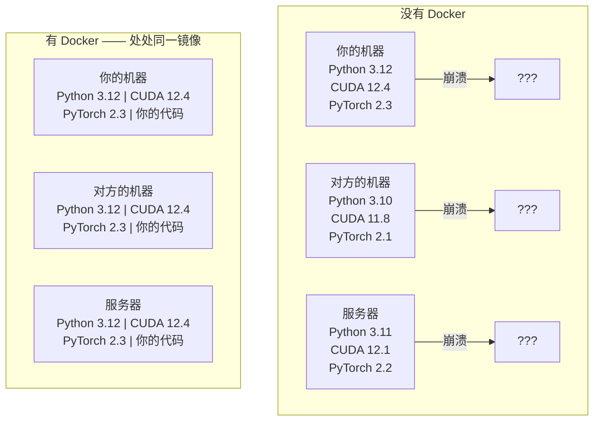

# AI 用 Docker

> 容器让"在我机器上是好的"成为历史。

**类型:** Build
**语言:** Docker
**先修:** 阶段 0，第 01 与 03 课
**时长:** ~60 分钟

## 学习目标

- 用 Dockerfile 构建带 CUDA、PyTorch 和 AI 库的 GPU 镜像
- 把宿主目录挂载为卷，在重建容器时保留模型、数据集和代码
- 配置 NVIDIA Container Toolkit，在容器内暴露 GPU
- 用 Docker Compose 编排多服务 AI 应用（推理服务器 + 向量数据库）

## 问题

你在笔记本上用 PyTorch 2.3、CUDA 12.4 和 Python 3.12 训练了一个模型。同事的机器上是 PyTorch 2.1、CUDA 11.8 和 Python 3.10。模型在他们机器上崩了。而你的 Dockerfile 在两边都能跑。

AI 项目是依赖噩梦。典型技术栈包括 Python、PyTorch、CUDA 驱动、cuDNN、系统级 C 库，以及像 flash-attn 这种需要精确编译器版本的专用包。Docker 把这一切打包成一个镜像，在哪儿跑都一样。

## 概念

Docker 把你的代码、运行时、库和系统工具包装进一个叫容器的隔离单元。可以把它想成轻量级虚拟机，只不过它共享宿主 OS 内核而不是自己跑一套，所以几秒就能启动，而不是几分钟。



### 为什么 AI 项目比大多数项目更需要 Docker

1. **GPU 驱动很脆弱。** CUDA 12.4 的代码无法在 CUDA 11.8 上运行。Docker 把 CUDA 工具包隔离在容器内，同时通过 NVIDIA Container Toolkit 共享宿主 GPU 驱动。

2. **模型权重很大。** 一个 70 亿参数的模型用 fp16 存储约 14 GB。你不会想每次重建都重新下载。Docker 卷可以把宿主上的 models 目录挂载进来。

3. **多服务架构很常见。** 真实的 AI 应用不只是一段 Python 脚本。它有推理服务器、RAG 用的向量数据库，可能还有 Web 前端。Docker Compose 一条命令就能编排全部。

### 关键词汇

| 术语 | 含义 |
|------|------|
| 镜像（Image） | 只读模板。你的配方。由 Dockerfile 构建。 |
| 容器（Container） | 镜像的运行实例。你的厨房。 |
| Dockerfile | 构建镜像的指令。逐层构建。 |
| 卷（Volume） | 在容器重启后仍然存在的持久存储。 |
| docker-compose | 用 YAML 定义多容器应用的工具。 |

### AI 中常见的容器模式

```
Dev Container
  Full toolkit. Editor support. Jupyter. Debugging tools.
  Used during development and experimentation.

Training Container
  Minimal. Just the training script and dependencies.
  Runs on GPU clusters. No editor, no Jupyter.

Inference Container
  Optimized for serving. Small image. Fast cold start.
  Runs behind a load balancer in production.
```

```figure
s0-image-layers
```

## 动手做

### 步骤 1：安装 Docker

```bash
# macOS
brew install --cask docker
open /Applications/Docker.app

# Ubuntu
curl -fsSL https://get.docker.com | sh
sudo usermod -aG docker $USER
# Log out and back in for group change to take effect
```

验证：

```bash
docker --version
docker run hello-world
```

### 步骤 2：安装 NVIDIA Container Toolkit（带 NVIDIA GPU 的 Linux）

它让 Docker 容器访问你的 GPU。macOS 和 Windows（WSL2）用户可跳过；Docker Desktop 在这些平台上用不同的方式处理 GPU 直通。

```bash
distribution=$(. /etc/os-release;echo $ID$VERSION_ID)
curl -fsSL https://nvidia.github.io/libnvidia-container/gpgkey | sudo gpg --dearmor -o /usr/share/keyrings/nvidia-container-toolkit-keyring.gpg
curl -s -L https://nvidia.github.io/libnvidia-container/$distribution/libnvidia-container.list | \
    sed 's#deb https://#deb [signed-by=/usr/share/keyrings/nvidia-container-toolkit-keyring.gpg] https://#g' | \
    sudo tee /etc/apt/sources.list.d/nvidia-container-toolkit.list

sudo apt-get update
sudo apt-get install -y nvidia-container-toolkit
sudo nvidia-ctk runtime configure --runtime=docker
sudo systemctl restart docker
```

在容器内测试 GPU 访问：

```bash
docker run --rm --gpus all nvidia/cuda:12.4.1-base-ubuntu22.04 nvidia-smi
```

如果能看到 GPU 信息，说明 toolkit 已正常工作。

### 步骤 3：理解基础镜像

选对基础镜像能省下几个小时的调试。

```
nvidia/cuda:12.4.1-devel-ubuntu22.04
  Full CUDA toolkit. Compilers included.
  Use for: building packages that need nvcc (flash-attn, bitsandbytes)
  Size: ~4 GB

nvidia/cuda:12.4.1-runtime-ubuntu22.04
  CUDA runtime only. No compilers.
  Use for: running pre-built code
  Size: ~1.5 GB

pytorch/pytorch:2.6.0-cuda12.4-cudnn9-runtime
  PyTorch pre-installed on top of CUDA.
  Use for: skipping the PyTorch install step
  Size: ~6 GB

python:3.12-slim
  No CUDA. CPU only.
  Use for: inference on CPU, lightweight tools
  Size: ~150 MB
```

### 步骤 4：为 AI 开发编写 Dockerfile

下面是 `code/Dockerfile` 中的 Dockerfile。逐段来看：

```dockerfile
FROM --platform=linux/amd64 nvidia/cuda:12.4.1-devel-ubuntu22.04

ENV DEBIAN_FRONTEND=noninteractive
ENV PYTHONUNBUFFERED=1

RUN apt-get update && apt-get install -y --no-install-recommends \
    software-properties-common \
    git \
    curl \
    build-essential \
    && add-apt-repository -y ppa:deadsnakes/ppa \
    && apt-get update && apt-get install -y --no-install-recommends \
    python3.12 \
    python3.12-venv \
    python3.12-dev \
    && rm -rf /var/lib/apt/lists/*

RUN update-alternatives --install /usr/bin/python python /usr/bin/python3.12 1

RUN curl -sSL https://raw.githubusercontent.com/pypa/get-pip/3b73145063be545b649ad9ca83ea8da5fc915a4f/public/get-pip.py -o /tmp/get-pip.py \
    && echo "a341e1a43e38001c551a1508a73ff23636a11970b61d901d9a1cad2a18f57055  /tmp/get-pip.py" | sha256sum -c - \
    && python /tmp/get-pip.py \
    && rm /tmp/get-pip.py \
    && update-alternatives --install /usr/bin/pip pip /usr/local/bin/pip3.12 1

RUN python -m pip install --no-cache-dir --upgrade pip setuptools wheel

RUN python -m pip install --no-cache-dir \
    torch==2.6.0+cu124 \
    torchvision==0.21.0+cu124 \
    torchaudio==2.6.0+cu124 \
    --index-url https://download.pytorch.org/whl/cu124

RUN python -m pip install --no-cache-dir \
    numpy \
    pandas \
    scikit-learn \
    matplotlib \
    jupyter \
    transformers \
    datasets \
    accelerate \
    safetensors

WORKDIR /workspace

VOLUME ["/workspace", "/models"]

EXPOSE 8888

CMD ["python"]
```

构建：

```bash
docker build -t ai-dev -f phases/00-setup-and-tooling/07-docker-for-ai/code/Dockerfile .
```

第一次会比较慢（下载 CUDA 基础镜像 + PyTorch）。后续构建会用到缓存层。

**macOS / Apple Silicon (M1/M2/M3/M4)：** `FROM` 行上的 `--platform=linux/amd64` 是让这个构建在 Mac 上成功的关键。CUDA 基础镜像也发布了 arm64 变体，Docker Desktop 在 Apple Silicon 上会自动选它，但 PyTorch 只为 x86_64 发布 `cu124` wheel，所以 `pip install torch==2.6.0+cu124` 那层会报 `No matching distribution found for torch==2.6.0+cu124`。固定平台会拉取 x86_64 镜像并在仿真下运行：构建更慢，容器也没有 GPU（Mac 上本来就没有 CUDA）。在 Mac 上请去掉下面 `docker run` 命令中的 `--gpus all`。若要在 Apple Silicon 上做 GPU 相关工作，请用第 01 课的 MPS 构建原生运行课程内容，把本镜像留给带 NVIDIA GPU 的 x86_64 Linux 主机。

运行：

```bash
docker run --rm -it --gpus all \
    -v $(pwd):/workspace \
    -v ~/models:/models \
    ai-dev python -c "import torch; print(f'PyTorch {torch.__version__}, CUDA: {torch.cuda.is_available()}')"
```

在容器内运行 Jupyter：

```bash
docker run --rm -it --gpus all \
    -v $(pwd):/workspace \
    -v ~/models:/models \
    -p 8888:8888 \
    ai-dev jupyter notebook --ip=0.0.0.0 --port=8888 --no-browser --allow-root
```

### 步骤 5：为数据和模型做卷挂载

卷挂载对 AI 工作至关重要。没有它们，你 14 GB 的模型下载会在容器停止后消失。

```bash
# Mount your code
-v $(pwd):/workspace

# Mount a shared models directory
-v ~/models:/models

# Mount datasets
-v ~/datasets:/data
```

在训练脚本中，从挂载路径加载：

```python
from transformers import AutoModel

model = AutoModel.from_pretrained("/models/llama-7b")
```

模型存放在宿主文件系统上。可以随意重建容器，无需重新下载。

### 步骤 6：用 Docker Compose 跑多服务 AI 应用

一个真正的 RAG 应用需要推理服务器和向量数据库。Docker Compose 一条命令就能同时跑起来。

见 `code/docker-compose.yml`：

```yaml
services:
  ai-dev:
    build:
      context: .
      dockerfile: Dockerfile
    deploy:
      resources:
        reservations:
          devices:
            - driver: nvidia
              count: all
              capabilities: [gpu]
    volumes:
      - ../../../:/workspace
      - ~/models:/models
      - ~/datasets:/data
    ports:
      - "8888:8888"
    stdin_open: true
    tty: true
    command: jupyter notebook --ip=0.0.0.0 --port=8888 --no-browser --allow-root

  qdrant:
    image: qdrant/qdrant:v1.12.5
    ports:
      - "6333:6333"
      - "6334:6334"
    volumes:
      - qdrant_data:/qdrant/storage

volumes:
  qdrant_data:
```

启动全部：

```bash
cd phases/00-setup-and-tooling/07-docker-for-ai/code
docker compose up -d
```

现在你的 AI 开发容器可以通过服务名访问 `http://qdrant:6333` 上的向量数据库。Docker Compose 会自动创建共享网络。

从 AI 容器内测试连接：

```python
from qdrant_client import QdrantClient

client = QdrantClient(host="qdrant", port=6333)
print(client.get_collections())
```

停止全部：

```bash
docker compose down
```

加 `-v` 可同时删除 qdrant 卷：

```bash
docker compose down -v
```

### 步骤 7：AI 工作常用的 Docker 命令

```bash
# List running containers
docker ps

# List all images and their sizes
docker images

# Remove unused images (reclaim disk space)
docker system prune -a

# Check GPU usage inside a running container
docker exec -it <container_id> nvidia-smi

# Copy a file from container to host
docker cp <container_id>:/workspace/results.csv ./results.csv

# View container logs
docker logs -f <container_id>
```

## 用起来

你现在有了可复现的 AI 开发环境。本课程其余部分：

- 用 `docker compose up` 同时启动开发环境和向量数据库
- 把代码、模型和数据挂载为卷，重建时不会丢失
- 某课需要新的 Python 包时，把它加进 Dockerfile 再重建
- 把 Dockerfile 分享给队友，他们能得到完全相同的环境

### 没有 GPU？

去掉 `--gpus all` 标志和 NVIDIA deploy 配置块。容器仍可用于基于 CPU 的课程。PyTorch 会检测到没有 CUDA 并自动回退到 CPU。

## 练习

1. 构建 Dockerfile，并在容器内运行 `python -c "import torch; print(torch.__version__)"`
2. 启动 docker-compose 栈，并确认可从 AI 容器访问 `http://qdrant:6333/collections` 上的 Qdrant
3. 把 `flask` 加进 Dockerfile，重建，然后在 5000 端口跑一个简单 API 服务。用 `-p 5000:5000` 映射端口
4. 用 `docker images` 测量镜像大小。尝试把基础镜像从 `devel` 换成 `runtime`，比较体积

## 关键术语

| 术语 | 常见说法 | 实际含义 |
|------|----------|----------|
| 容器 | "轻量级虚拟机" | 使用宿主内核的隔离进程，拥有自己的文件系统和网络 |
| 镜像层 | "缓存的步骤" | 每条 Dockerfile 指令生成一层。未变更的层会被缓存，所以重建很快。 |
| NVIDIA Container Toolkit | "Docker 里的 GPU" | 通过 `--gpus` 标志把宿主 GPU 暴露给容器的运行时钩子 |
| 卷挂载 | "共享文件夹" | 映射进容器的宿主目录。容器停止后更改仍保留。 |
| 基础镜像 | "起点" | Dockerfile 在其上构建的 `FROM` 镜像。决定了预装了什么。 |
