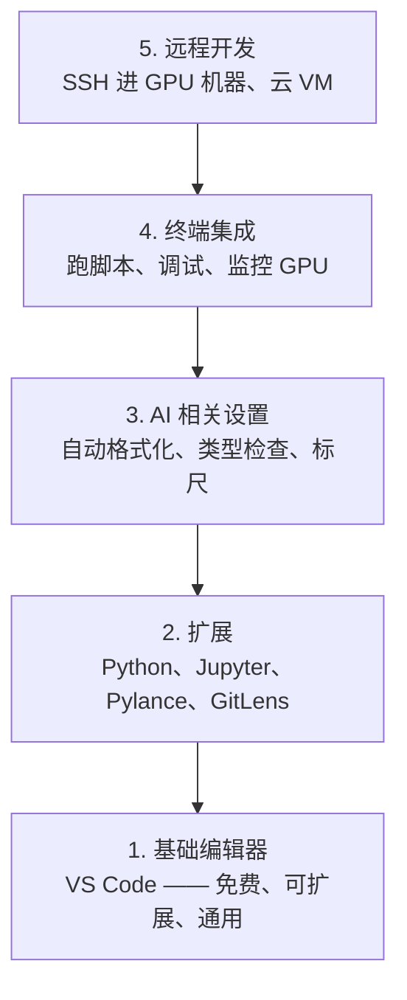

# 编辑器配置

> 编辑器是你的副驾驶。一次配置到位，让它不挡路、开始出力。

**类型:** Build
**语言:** --
**先修:** 阶段 0，第 01 课
**时长:** ~20 分钟

## 学习目标

- 安装 VS Code 及 Python、Jupyter、lint、远程 SSH 等必备扩展
- 配置保存时格式化、类型检查和 notebook 输出滚动，适配 AI 工作流
- 配置 Remote SSH，像本地一样编辑和调试远程 GPU 机器上的代码
- 评估编辑器替代品（Cursor、Windsurf、Neovim）及其在 AI 工作中的取舍

## 问题

你会在编辑器里花上几千小时：写 Python、跑 notebook、调试训练循环、SSH 进 GPU 机器。配置不当的编辑器会让每次开写都充满摩擦：没有自动补全、没有类型提示、没有行内报错、手动格式化、终端工作流别扭。

正确的配置花 20 分钟。跳过它，你每天都要赔 20 分钟。

## 概念

AI 工程的编辑器配置需要五件事：



```figure
s0-lsp-roundtrip
```

## 动手做

### 步骤 1：安装 VS Code

推荐使用 VS Code。它免费、跨平台、对 Jupyter notebook 支持一流，扩展生态覆盖 AI 工作所需的一切。

从 [code.visualstudio.com](https://code.visualstudio.com/) 下载。

在终端验证：

```bash
code --version
```

如果 macOS 上找不到 `code`，打开 VS Code，按 `Cmd+Shift+P`，输入 "Shell Command"，选择 "Install 'code' command in PATH"。

### 步骤 2：安装必备扩展

在 VS Code 中打开集成终端（各平台均为 `` Ctrl+` ``），安装对 AI 工作重要的扩展：

```bash
code --install-extension ms-python.python
code --install-extension ms-python.vscode-pylance
code --install-extension ms-toolsai.jupyter
code --install-extension eamodio.gitlens
code --install-extension ms-vscode-remote.remote-ssh
code --install-extension ms-python.debugpy
code --install-extension ms-python.black-formatter
code --install-extension charliermarsh.ruff
```

各扩展的作用：

| 扩展 | 为什么装 |
|------|----------|
| Python | 语言支持、虚拟环境检测、运行/调试 |
| Pylance | 快速类型检查、自动补全、import 解析 |
| Jupyter | 在 VS Code 内运行 notebook、变量浏览器 |
| GitLens | 查看谁改了什么、行内 git blame |
| Remote SSH | 像本地一样打开远程 GPU 机器上的文件夹 |
| Debugpy | Python 单步调试 |
| Black Formatter | 保存时自动格式化，风格统一 |
| Ruff | 快速 lint，捕捉常见错误 |

本课的 `code/.vscode/extensions.json` 含完整推荐列表。打开项目文件夹时，VS Code 会提示你安装它们。

### 步骤 3：配置设置

复制本课 `code/.vscode/settings.json` 中的设置，或通过 `Settings > Open Settings (JSON)` 手动应用。

对 AI 工作关键的设置：

```jsonc
{
    "python.analysis.typeCheckingMode": "basic",
    "editor.formatOnSave": true,
    "editor.rulers": [88, 120],
    "notebook.output.scrolling": true,
    "files.autoSave": "afterDelay"
}
```

为什么这些重要：

- **基础类型检查**：在运行前捕捉参数类型错误。在张量形状不匹配和 API 参数写错时省下调试时间。
- **保存时格式化**：再也不用想格式问题。Black 会处理。
- **88 和 120 标尺**：Black 在 88 处换行。120 标记提示 docstring 和注释是否过长。
- **Notebook 输出滚动**：训练循环会打印几千行。不滚动的话，输出面板会炸开。
- **自动保存**：你会忘记保存，训练脚本会跑旧代码。自动保存能防止这一点。

### 步骤 4：终端集成

VS Code 的集成终端是你跑训练脚本、监控 GPU 和管理环境的地方。

正确配置它：

```jsonc
{
    "terminal.integrated.defaultProfile.osx": "zsh",
    "terminal.integrated.defaultProfile.linux": "bash",
    "terminal.integrated.fontSize": 13,
    "terminal.integrated.scrollback": 10000
}
```

常用快捷键：

| 操作 | macOS | Linux/Windows |
|------|-------|---------------|
| 切换终端 | `` Ctrl+` `` | `` Ctrl+` `` |
| 新建终端 | `` Ctrl+Shift+` `` | `` Ctrl+Shift+` `` |
| 分屏终端 | `Cmd+\` | `Ctrl+Shift+5` |

分屏终端很有用：一个跑脚本，一个用 `nvidia-smi -l 1` 或 `watch -n 1 nvidia-smi` 监控 GPU。

### 步骤 5：远程开发（SSH 进 GPU 机器）

这是 AI 工作最重要的扩展。你会在远程机器上跑训练（云 VM、实验室服务器、Lambda、Vast.ai）。Remote SSH 让你打开远程文件系统、编辑文件、开终端、调试，就像都在本地一样。

配置：

1. 安装 Remote SSH 扩展（步骤 2 已完成）。
2. 按 `Ctrl+Shift+P`（或 `Cmd+Shift+P`），输入 "Remote-SSH: Connect to Host"。
3. 输入 `user@your-gpu-box-ip`。
4. VS Code 会自动在远程机器上安装其服务端组件。

要免密访问，配置 SSH 密钥：

```bash
ssh-keygen -t ed25519 -C "your-email@example.com"
ssh-copy-id user@your-gpu-box-ip
```

为方便起见，把主机加进 `~/.ssh/config`：

```
Host gpu-box
    HostName 203.0.113.50
    User ubuntu
    IdentityFile ~/.ssh/id_ed25519
    ForwardAgent yes
```

现在 `Remote-SSH: Connect to Host > gpu-box` 可以秒连。

## 替代方案

### Cursor

[cursor.com](https://cursor.com) 是内置 AI 代码生成的 VS Code 分支。它使用相同的扩展生态和设置格式。如果你用 Cursor，本课的一切仍然适用。导入同样的 `settings.json` 和 `extensions.json` 即可。

### Windsurf

[windsurf.com](https://windsurf.com) 是另一个 AI 优先的 VS Code 分支。情况相同：同样的扩展、同样的设置格式、同样的 Remote SSH 支持。

### Vim/Neovim

如果你已经在用 Vim 或 Neovim 且效率很高，就留在那里。AI Python 工作的最低配置：

- **pyright** 或 **pylsp** 做类型检查（通过 Mason 或手动安装）
- **nvim-lspconfig** 做语言服务器集成
- **jupyter-vim** 或 **molten-nvim** 做类 notebook 执行
- **telescope.nvim** 做文件/符号搜索
- **none-ls.nvim** 配合 black 和 ruff 做格式化/lint

如果你还没在用 Vim，现在别开始。学习曲线会和学 AI 工程抢时间。用 VS Code。

## 用起来

有了这套配置，你的日常工作流是：

1. 在 VS Code 中打开项目文件夹（或通过 Remote SSH 连到 GPU 机器）。
2. 在编辑器里写 Python，享受自动补全、类型提示和行内报错。
3. 用 Jupyter 扩展内联运行 notebook。
4. 用集成终端跑训练脚本、`uv pip install` 和 GPU 监控。
5. 提交前用 GitLens 审查改动。

## 练习

1. 安装 VS Code 和步骤 2 列出的全部扩展
2. 把本课的 `settings.json` 复制进你的 VS Code 配置
3. 打开一个 Python 文件，确认 Pylance 显示类型提示、Black 在保存时格式化
4. 如果你能访问远程机器，配置 Remote SSH 并打开其上的一个文件夹

## 关键术语

| 术语 | 常见说法 | 实际含义 |
|------|----------|----------|
| LSP | "自动补全引擎" | Language Server Protocol：编辑器从语言专用服务器获取类型信息、补全和诊断的标准 |
| Pylance | "Python 插件" | 微软的 Python 语言服务器，用 Pyright 做类型检查和 IntelliSense |
| Remote SSH | "在服务器上干活" | VS Code 扩展，在远程机器上跑轻量服务端，并把 UI 流式传到本地编辑器 |
| 保存时格式化 | "自动美化" | 编辑器在每次保存时运行格式化器（Black、Ruff），保证代码风格始终一致 |
