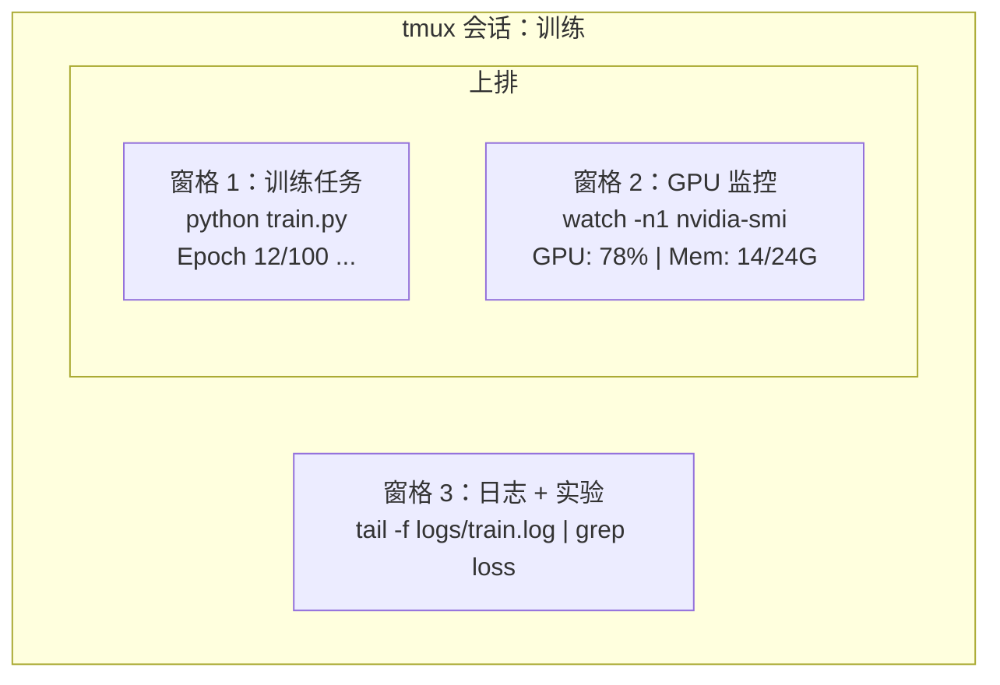

# 终端与 Shell

> 终端是 AI 工程师的主战场。在这里待舒服了。

**类型:** Learn
**语言:** --
**先修:** Phase 0, Lesson 01
**时长:** ~35 分钟

## 学习目标

- 用管道、重定向和 `grep` 在命令行过滤和处理训练日志
- 用 tmux 创建带多窗格的持久会话，同时跑训练和监控 GPU
- 用 `htop`、`nvtop` 和 `nvidia-smi` 监控系统与 GPU 资源
- 用 SSH、`scp` 和 `rsync` 在本地与远程机器之间传文件

## 问题

你在终端里花的时间会比任何编辑器都多。训练任务、GPU 监控、日志跟踪、远程 SSH 会话、环境管理——所有 AI 工作流都离不开 shell。这里慢，处处慢。

本课只讲 AI 工作真正需要的终端技能。不讲 Unix 历史，不深挖 Bash 脚本。够用就行。

## 概念



三件事同时跑，只需一个终端。你可以 detach、回家、SSH 回来再 attach，训练一直在跑。

```figure
s0-shell-pipeline
```

## 动手做

### 步骤 1：了解你的 shell

看看你用的是哪个 shell：

```bash
echo $SHELL
```

大多数系统是 `bash` 或 `zsh`。两者都行。本课程的命令在两者中都能用。

必知要点：

```bash
# Move around
cd ~/projects/ai-engineering-from-scratch
pwd
ls -la

# History search (most useful shortcut you'll learn)
# Ctrl+R then type part of a previous command
# Press Ctrl+R again to cycle through matches

# Clear terminal
clear   # or Ctrl+L

# Cancel a running command
# Ctrl+C

# Suspend a running command (resume with fg)
# Ctrl+Z
```

### 步骤 2：管道与重定向

管道把命令串起来。处理日志、过滤输出、串联工具都靠它。你会一直用。

```bash
# Count how many times "loss" appears in a log
cat train.log | grep "loss" | wc -l

# Extract just the loss values from training output
grep "loss:" train.log | awk '{print $NF}' > losses.txt

# Watch a log file update in real time, filtering for errors
tail -f train.log | grep --line-buffered "ERROR"

# Sort experiments by final accuracy
grep "final_accuracy" results/*.log | sort -t= -k2 -n -r

# Redirect stdout and stderr to separate files
python train.py > output.log 2> errors.log

# Redirect both to the same file
python train.py > train_full.log 2>&1
```

需要掌握的重定向符号：

| 符号 | 作用 |
|--------|-------------|
| `>` | 把 stdout 写入文件（覆盖） |
| `>>` | 把 stdout 追加到文件 |
| `2>` | 把 stderr 写入文件 |
| `2>&1` | 把 stderr 送到与 stdout 相同的位置 |
| `\|` | 把前一个命令的 stdout 作为下一个命令的 stdin |

### 步骤 3：后台进程

训练一跑就是几小时，你不会想一直开着终端。

```bash
# Run in background (output still goes to terminal)
python train.py &

# Run in background, immune to hangup (closing terminal won't kill it)
nohup python train.py > train.log 2>&1 &

# Check what's running in background
jobs
ps aux | grep train.py

# Bring a background job to foreground
fg %1

# Kill a background process
kill %1
# or find its PID and kill that
kill $(pgrep -f "train.py")
```

`&`、`nohup` 和 `screen`/`tmux` 的区别：

| 方式 | 关终端后还活着？ | 能重新接入？ |
|--------|-------------------------|---------------|
| `command &` | 否 | 否 |
| `nohup command &` | 是 | 否（查日志文件） |
| `screen` / `tmux` | 是 | 是 |

超过几分钟的任务，一律用 tmux。

### 步骤 4：tmux

tmux 让你创建带多窗格的持久终端会话。管理训练任务，它是最好用的工具。

```bash
# Install
# macOS
brew install tmux
# Ubuntu
sudo apt install tmux

# Start a named session
tmux new -s training

# Split horizontally
# Ctrl+B then "

# Split vertically
# Ctrl+B then %

# Navigate between panes
# Ctrl+B then arrow keys

# Detach (session keeps running)
# Ctrl+B then d

# Reattach
tmux attach -t training

# List sessions
tmux ls

# Kill a session
tmux kill-session -t training
```

典型的 AI 工作流会话：

```bash
tmux new -s train

# Pane 1: start training
python train.py --epochs 100 --lr 1e-4

# Ctrl+B, " to split, then run GPU monitor
watch -n1 nvidia-smi

# Ctrl+B, % to split vertically, tail the logs
tail -f logs/experiment.log

# Now detach with Ctrl+B, d
# SSH out, go get coffee, come back
# tmux attach -t train
```

### 步骤 5：用 htop 和 nvtop 监控

```bash
# System processes (better than top)
htop

# GPU processes (if you have NVIDIA GPU)
# Install: sudo apt install nvtop (Ubuntu) or brew install nvtop (macOS)
nvtop

# Quick GPU check without nvtop
nvidia-smi

# Watch GPU usage update every second
watch -n1 nvidia-smi

# See which processes are using the GPU
nvidia-smi --query-compute-apps=pid,name,used_memory --format=csv
```

`htop` 常用快捷键：
- `F6` 或 `>` 按列排序（按内存排序可找出内存泄漏）
- `F5` 切换树状视图（查看子进程）
- `F9` 杀掉进程
- `/` 搜索进程名

### 步骤 6：用 SSH 连接远程 GPU 机器

租云 GPU（Lambda、RunPod、Vast.ai）时，你通过 SSH 连接。

```bash
# Basic connection
ssh user@gpu-box-ip

# With a specific key
ssh -i ~/.ssh/my_gpu_key user@gpu-box-ip

# Copy files to remote
scp model.pt user@gpu-box-ip:~/models/

# Copy files from remote
scp user@gpu-box-ip:~/results/metrics.json ./

# Sync a whole directory (faster for many files)
rsync -avz ./data/ user@gpu-box-ip:~/data/

# Port forward (access remote Jupyter/TensorBoard locally)
ssh -L 8888:localhost:8888 user@gpu-box-ip
# Now open localhost:8888 in your browser

# SSH config for convenience
# Add to ~/.ssh/config:
# Host gpu
#     HostName 192.168.1.100
#     User ubuntu
#     IdentityFile ~/.ssh/gpu_key
#
# Then just:
# ssh gpu
```

### 步骤 7：AI 常用 alias

把下面这些加到 `~/.bashrc` 或 `~/.zshrc`：

```bash
source phases/00-setup-and-tooling/10-terminal-and-shell/code/shell_aliases.sh
```

或者只挑你要的。关键 alias：

```bash
# GPU status at a glance
alias gpu='nvidia-smi --query-gpu=index,name,utilization.gpu,memory.used,memory.total,temperature.gpu --format=csv,noheader'

# Kill all Python training processes
alias killtraining='pkill -f "python.*train"'

# Quick virtual environment activate
alias ae='source .venv/bin/activate'

# Watch training loss
alias watchloss='tail -f logs/*.log | grep --line-buffered "loss"'
```

完整列表见 `code/shell_aliases.sh`。

### 步骤 8：常见 AI 终端模式

这些模式在实践中反复出现：

```bash
# Run training, log everything, notify when done
python train.py 2>&1 | tee train.log; echo "DONE" | mail -s "Training complete" you@email.com

# Compare two experiment logs side by side
diff <(grep "accuracy" exp1.log) <(grep "accuracy" exp2.log)

# Find the largest model files (clean up disk space)
find . -name "*.pt" -o -name "*.safetensors" | xargs du -h | sort -rh | head -20

# Download a model from Hugging Face
wget https://huggingface.co/model/resolve/main/model.safetensors

# Untar a dataset
tar xzf dataset.tar.gz -C ./data/

# Count lines in all Python files (see how big your project is)
find . -name "*.py" | xargs wc -l | tail -1

# Check disk space (training data fills disks fast)
df -h
du -sh ./data/*

# Environment variable check before training
env | grep -i cuda
env | grep -i torch
```

## 用起来

本课程中各工具的使用时机：

| 工具 | 什么时候用 |
|------|----------------|
| tmux | 每次训练任务（Phase 3 起） |
| `tail -f` + `grep` | 监控训练日志 |
| `nohup` / `&` | 快速后台任务 |
| `htop` / `nvtop` | 排查训练缓慢、OOM 错误 |
| SSH + `rsync` | 在云 GPU 上干活 |
| 管道 + 重定向 | 处理实验结果 |
| alias | 给重复命令省时间 |

## 练习

1. 安装 tmux，创建一个三窗格会话：一个跑 `htop`，一个跑 `watch -n1 date`，第三个跑 Python 脚本。detach 再 reattach。
2. 把 `code/shell_aliases.sh` 里的 alias 加进 shell 配置，用 `source ~/.zshrc`（或 `~/.bashrc`）重载。
3. 用 `for i in $(seq 1 100); do echo "epoch $i loss: $(echo "scale=4; 1/$i" | bc)"; sleep 0.1; done > fake_train.log` 造一份假训练日志，再用 `grep`、`tail`、`awk` 只抽出 loss 数值。
4. 为你有权限的服务器配置一条 SSH config（或用 `localhost` 练语法）。

## 关键术语

| 术语 | 人们怎么说 | 实际含义 |
|------|----------------|----------------------|
| Shell | "终端" | 解释你命令的程序（bash、zsh、fish） |
| tmux | "终端复用器" | 在一个窗口里跑多个终端会话，并支持 detach/reattach 的程序 |
| Pipe | "那根竖线" | 把一个命令的输出作为另一个命令输入的 `\|` 操作符 |
| PID | "进程号" | 每个运行中进程的唯一编号，用来监控或杀掉它 |
| nohup | "不挂断" | 让命令免疫挂断信号，关终端也不会杀掉它 |
| SSH | "连服务器" | Secure Shell，用于在远程机器上执行命令的加密协议 |
