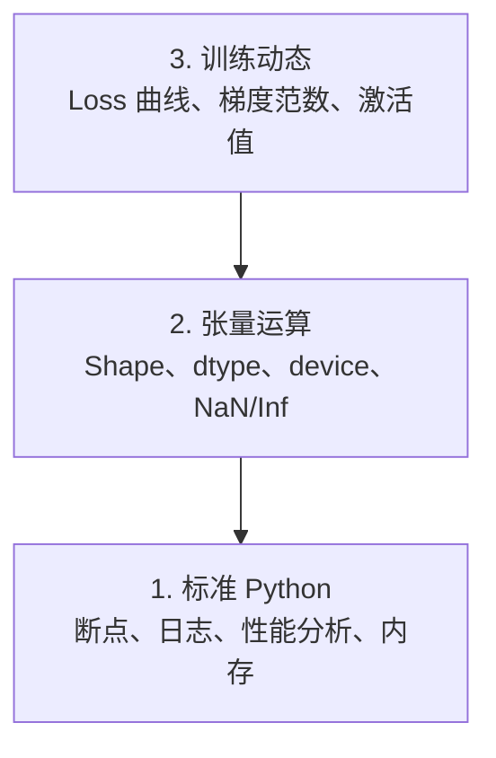

# 调试与性能分析

> 最糟的 AI bug 不会崩溃。它们安静地在垃圾数据上训练，还画出一条漂亮的 loss 曲线。

**类型:** Build
**语言:** Python
**先修:** Lesson 1 (Dev Environment)、基本 PyTorch
**时长:** ~60 分钟

## 学习目标

- 用条件 `breakpoint()` 和 `debug_print` 在训练中途检查张量的 shape、dtype 和 NaN
- 用 `cProfile`、`line_profiler` 和 `tracemalloc` 分析训练循环，找出瓶颈
- 检测常见 AI bug：shape 不匹配、NaN loss、数据泄漏、张量在错误设备上
- 配置 TensorBoard，可视化 loss 曲线、权重直方图和梯度分布

## 问题

AI 代码的失败方式和普通代码不同。Web 应用崩溃会留下堆栈跟踪。一个配置错误的训练循环会跑 8 小时、烧掉 200 美元 GPU 时间，最后产出一个对每个输入都预测均值的模型。代码从头到尾没报过错。bug 是张量放错了设备、忘了 `.detach()`，或者标签泄漏进了特征。

你需要能抓住这些静默失败的调试工具，在它们浪费你的时间和算力之前。

## 概念

AI 调试分三个层次：



大多数人直接跳到第 3 层（盯着 TensorBoard）。但 80% 的 AI bug 在第 1、2 层。

```figure
s0-flame-hot
```

## 动手做

### Part 1：Print 调试（没错，它管用）

Print 调试常被轻视。其实不该。对张量代码，一条有针对性的 print 胜过单步 debugger，因为你需要同时看到 shape、dtype 和取值范围。

```python
def debug_print(name, tensor):
    print(f"{name}: shape={tensor.shape}, dtype={tensor.dtype}, "
          f"device={tensor.device}, "
          f"min={tensor.min().item():.4f}, max={tensor.max().item():.4f}, "
          f"mean={tensor.mean().item():.4f}, "
          f"has_nan={tensor.isnan().any().item()}")
```

每个可疑操作后调用一次。找到 bug 后把这些 print 删掉。就这么简单。

### Part 2：Python Debugger（pdb 与 breakpoint）

内置 debugger 在 AI 工作中被低估了。把 `breakpoint()` 丢进训练循环，交互式地检查张量。

```python
def training_step(model, batch, criterion, optimizer):
    inputs, labels = batch
    outputs = model(inputs)
    loss = criterion(outputs, labels)

    if loss.item() > 100 or torch.isnan(loss):
        breakpoint()

    loss.backward()
    optimizer.step()
```

进入 debugger 后，有用的命令：

- `p outputs.shape` 检查 shape
- `p loss.item()` 查看 loss 值
- `p torch.isnan(outputs).sum()` 统计 NaN 个数
- `p model.fc1.weight.grad` 检查梯度
- `c` 继续，`q` 退出

这是条件调试——只在可疑时停下来。对一个 10,000 步的训练，这很关键。

### Part 3：Python Logging

当调试不只是快速看一下时，用 logging 替换 print。

```python
import logging

logging.basicConfig(
    level=logging.INFO,
    format="%(asctime)s [%(levelname)s] %(message)s",
    handlers=[
        logging.FileHandler("training.log"),
        logging.StreamHandler()
    ]
)
logger = logging.getLogger(__name__)

logger.info("Starting training: lr=%.4f, batch_size=%d", lr, batch_size)
logger.warning("Loss spike detected: %.4f at step %d", loss.item(), step)
logger.error("NaN loss at step %d, stopping", step)
```

Logging 提供时间戳、严重级别和文件输出。凌晨 3 点训练挂掉时，你要的是日志文件，而不是早已滚出屏幕的终端输出。

### Part 4：给代码段计时

知道时间花在哪里，是优化的第一步。

```python
import time

class Timer:
    def __init__(self, name=""):
        self.name = name

    def __enter__(self):
        self.start = time.perf_counter()
        return self

    def __exit__(self, *args):
        elapsed = time.perf_counter() - self.start
        print(f"[{self.name}] {elapsed:.4f}s")

with Timer("data loading"):
    batch = next(dataloader_iter)

with Timer("forward pass"):
    outputs = model(batch)

with Timer("backward pass"):
    loss.backward()
```

常见结论：数据加载占了训练时间的 60%。解法是 DataLoader 里设 `num_workers > 0`，而不是换更快的 GPU。

### Part 5：cProfile 与 line_profiler

手动计时不够时：

```bash
python -m cProfile -s cumtime train.py
```

这会按累计时间排序，展示每个函数调用。要做逐行性能分析：

```bash
pip install line_profiler
```

```python
@profile
def train_step(model, data, target):
    output = model(data)
    loss = F.cross_entropy(output, target)
    loss.backward()
    return loss

# Run with: kernprof -l -v train.py
```

### Part 6：内存分析

#### 用 tracemalloc 看 CPU 内存

```python
import tracemalloc

tracemalloc.start()

# your code here
model = build_model()
data = load_dataset()

snapshot = tracemalloc.take_snapshot()
top_stats = snapshot.statistics("lineno")
for stat in top_stats[:10]:
    print(stat)
```

#### 用 memory_profiler 看 CPU 内存

```bash
pip install memory_profiler
```

```python
from memory_profiler import profile

@profile
def load_data():
    raw = read_csv("data.csv")       # watch memory jump here
    processed = preprocess(raw)       # and here
    return processed
```

用 `python -m memory_profiler your_script.py` 运行，查看逐行内存占用。

#### 用 PyTorch 看 GPU 内存

```python
import torch

if torch.cuda.is_available():
    print(torch.cuda.memory_summary())

    print(f"Allocated: {torch.cuda.memory_allocated() / 1e9:.2f} GB")
    print(f"Cached: {torch.cuda.memory_reserved() / 1e9:.2f} GB")
```

碰到 OOM（Out of Memory）时：

1. 减小 batch size（永远先试这个）
2. 用 `torch.cuda.empty_cache()` 释放缓存内存
3. 对大的中间变量用 `del tensor` 再接 `torch.cuda.empty_cache()`
4. 用混合精度（`torch.cuda.amp`）把内存占用减半
5. 对很深的模型用 gradient checkpointing

### Part 7：常见 AI Bug 及其捕捉方法

#### Shape 不匹配

最常见的 bug。张量是 `[batch, features]`，模型期望的却是 `[batch, channels, height, width]`。

```python
def check_shapes(model, sample_input):
    print(f"Input: {sample_input.shape}")
    hooks = []

    def make_hook(name):
        def hook(module, inp, out):
            in_shape = inp[0].shape if isinstance(inp, tuple) else inp.shape
            out_shape = out.shape if hasattr(out, "shape") else type(out)
            print(f"  {name}: {in_shape} -> {out_shape}")
        return hook

    for name, module in model.named_modules():
        hooks.append(module.register_forward_hook(make_hook(name)))

    with torch.no_grad():
        model(sample_input)

    for h in hooks:
        h.remove()
```

用一个样本 batch 跑一次。它会画出模型里每一次 shape 变换。

#### NaN Loss

NaN loss 意味着数值炸了。常见原因：

- 学习率过高
- 自定义 loss 里有除零
- 对零或负数取对数
- RNN 中梯度爆炸

```python
def detect_nan(model, loss, step):
    if torch.isnan(loss):
        print(f"NaN loss at step {step}")
        for name, param in model.named_parameters():
            if param.grad is not None:
                if torch.isnan(param.grad).any():
                    print(f"  NaN gradient in {name}")
                if torch.isinf(param.grad).any():
                    print(f"  Inf gradient in {name}")
        return True
    return False
```

#### 数据泄漏

你的模型在测试集上准确率 99%。听起来很棒。其实是 bug。

```python
def check_data_leakage(train_set, test_set, id_column="id"):
    train_ids = set(train_set[id_column].tolist())
    test_ids = set(test_set[id_column].tolist())
    overlap = train_ids & test_ids
    if overlap:
        print(f"DATA LEAKAGE: {len(overlap)} samples in both train and test")
        return True
    return False
```

还要检查时间泄漏：用未来数据预测过去。划分前先按时间戳排序。

#### 设备不对

不同设备（CPU vs GPU）上的张量会引发运行时错误。但有时一个张量悄悄留在 CPU 上，其他都在 GPU，训练只是变得很慢。

```python
def check_devices(model, *tensors):
    model_device = next(model.parameters()).device
    print(f"Model device: {model_device}")
    for i, t in enumerate(tensors):
        if t.device != model_device:
            print(f"  WARNING: tensor {i} on {t.device}, model on {model_device}")
```

### Part 8：TensorBoard 基础

TensorBoard 让你看到训练内部随时间的变化。

```bash
pip install tensorboard
```

```python
from torch.utils.tensorboard import SummaryWriter

writer = SummaryWriter("runs/experiment_1")

for step in range(num_steps):
    loss = train_step(model, batch)

    writer.add_scalar("loss/train", loss.item(), step)
    writer.add_scalar("lr", optimizer.param_groups[0]["lr"], step)

    if step % 100 == 0:
        for name, param in model.named_parameters():
            writer.add_histogram(f"weights/{name}", param, step)
            if param.grad is not None:
                writer.add_histogram(f"grads/{name}", param.grad, step)

writer.close()
```

启动：

```bash
tensorboard --logdir=runs
```

观察要点：

- **Loss 不下降**：学习率太低，或模型结构有问题
- **Loss 剧烈震荡**：学习率太高
- **Loss 变成 NaN**：数值不稳定（见上面 NaN 一节）
- **训练 loss 下降、验证 loss 上升**：过拟合
- **权重直方图塌缩到零**：梯度消失
- **梯度直方图爆炸**：需要梯度裁剪

### Part 9：VS Code Debugger

要做交互式调试，用 `launch.json` 配置 VS Code：

```json
{
    "version": "0.2.0",
    "configurations": [
        {
            "name": "Debug Training",
            "type": "debugpy",
            "request": "launch",
            "program": "${file}",
            "console": "integratedTerminal",
            "justMyCode": false
        }
    ]
}
```

点击行号槽设置断点。用 Variables 面板查看张量属性。Debug Console 可在执行中途运行任意 Python 表达式。

适合逐步调试数据预处理流水线、看清每个变换的时候使用。

## 用起来

能抓住大多数 AI bug 的调试流程：

1. **训练前**：用样本 batch 跑 `check_shapes`。确认输入输出维度符合预期。
2. **前 10 步**：对 loss、输出和梯度使用 `debug_print`。确认没有 NaN，数值在合理范围。
3. **训练中**：记录 loss、学习率和梯度范数。用 TensorBoard 做可视化。
4. **出问题时**：在失败点丢入 `breakpoint()`。交互式检查张量。
5. **关注性能时**：给数据加载、前向、反向分别计时。接近 OOM 就分析内存。

## 交付

运行调试工具脚本：

```bash
python phases/00-setup-and-tooling/12-debugging-and-profiling/code/debug_tools.py
```

见 `outputs/prompt-debug-ai-code.md`，里面有一个帮助诊断 AI 专用 bug 的 prompt。

## 练习

1. 运行 `debug_tools.py` 并通读各段输出。改一下 dummy 模型引入一个 NaN（提示：前向传播中除以零），看检测器抓住它。
2. 用 `cProfile` 分析一个训练循环，找出最慢的函数。
3. 用 `tracemalloc` 找出数据加载流水线中哪一行分配了最多内存。
4. 为一次简单训练配置 TensorBoard，判断模型是否过拟合。
5. 在训练循环里使用 `breakpoint()`。练习在 debugger 提示符下检查张量的 shape、device 和梯度值。
