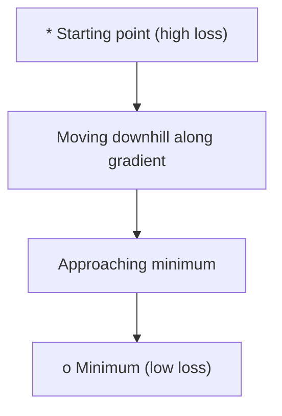
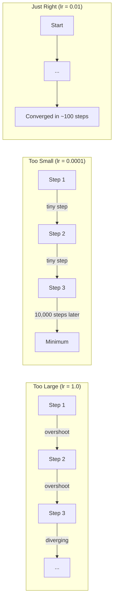
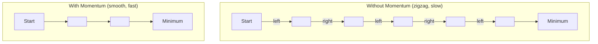
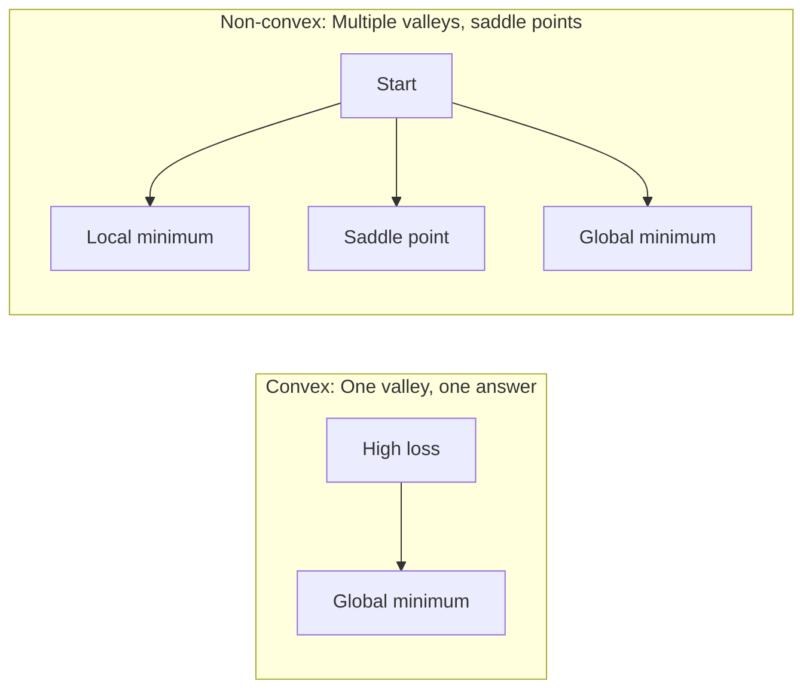
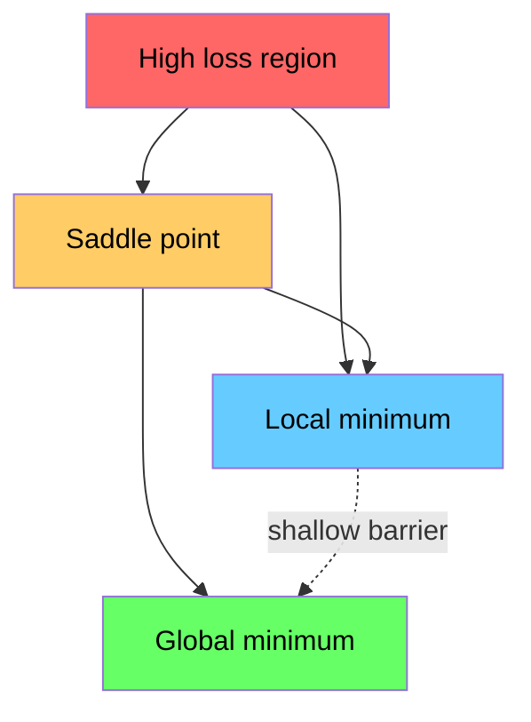

# 优化

> 训练神经网络，无非是找到谷底。

**类型:** Build
**语言:** Python
**先修:** Phase 1, Lessons 04-05 (Derivatives, Gradients)
**时长:** ~75 分钟

## 学习目标

- 从零实现普通梯度下降、带动量的 SGD 和 Adam
- 在 Rosenbrock 函数上比较优化器收敛速度，并解释 Adam 为何能按权重自适应学习率
- 区分凸与非凸损失曲面，并解释高维空间中鞍点的作用
- 配置学习率调度（阶梯衰减、余弦退火、warmup）以保证训练稳定

## 问题

你有一个损失函数。它告诉你模型错得有多厉害。你有梯度。它们告诉你哪个方向会让损失更糟。现在你需要一个下坡策略。

朴素做法很简单：朝梯度反方向移动。步长乘以一个叫学习率的数。重复。这就是梯度下降，它管用。但"管用"是有条件的。学习率太大，你会整个冲过谷底，在两壁之间来回弹。太小，你会在上千个多余步骤里慢慢爬向答案。撞上鞍点，你会停住不动，尽管你根本还没找到最小值。

深度学习中的每个优化器，都是对同一个问题的回答：如何更快、更可靠地到达谷底？

## 概念

### 优化是什么意思

优化是找到让函数最小化（或最大化）的输入值。在机器学习里，函数是损失，输入是模型权重。训练就是优化。

```
minimize L(w) where:
  L = loss function
  w = model weights (could be millions of parameters)
```

### 梯度下降（普通版）

最简单的优化器。计算损失对每个权重的梯度。把每个权重朝梯度反方向移动。步长由学习率缩放。

```
w = w - lr * gradient
```

这就是整个算法。一行。



### 学习率：最重要的超参数

学习率控制步长。它决定收敛的一切。



没有公式能给出正确的学习率。你靠实验找到它。常见起点：Adam 用 0.001，带动量的 SGD 用 0.01。

### SGD vs 批量 vs 小批量

普通梯度下降在整个数据集上计算梯度后才迈一步。这叫批量梯度下降（batch gradient descent）。它稳定但慢。

随机梯度下降（SGD）在单个随机样本上计算梯度并立刻迈步。它噪声大但快。

小批量梯度下降（mini-batch）取折中。在一个小批量（32、64、128、256 个样本）上计算梯度，然后迈步。这才是所有人真正在用的。

| 变体 | 批量大小 | 梯度质量 | 每步速度 | 噪声 |
|------|----------|----------|----------|------|
| 批量 GD | 整个数据集 | 精确 | 慢 | 无 |
| SGD | 1 个样本 | 噪声很大 | 快 | 高 |
| 小批量 | 32-256 | 良好估计 | 均衡 | 中等 |

SGD 和小批量里的噪声不是 bug。它有助于逃出浅的局部极小和鞍点。

### 动量：滚下山的球

普通梯度下降只看当前梯度。如果梯度来回锯齿（窄谷里很常见），进展就慢。动量（momentum）通过把历史梯度累积成速度项来修复这一点。

```
v = beta * v + gradient
w = w - lr * v
```

类比：一个滚下山的球。它不会在每个小凸起处停下重启。它在一致的方向上加速，并阻尼振荡。



`beta`（通常 0.9）控制保留多少历史。beta 越大，动量越大，路径越平滑，但对方向变化的响应越慢。

### Adam：自适应学习率

不同的权重需要不同的学习率。一个很少收到大梯度的权重，在终于收到大梯度时应该迈更大的步。一个不断收到巨大梯度的权重应该迈更小的步。

Adam（Adaptive Moment Estimation，自适应矩估计）为每个权重跟踪两样东西：

1. 一阶矩（m）：梯度的滑动平均（像动量）
2. 二阶矩（v）：梯度平方的滑动平均（梯度大小）

```
m = beta1 * m + (1 - beta1) * gradient
v = beta2 * v + (1 - beta2) * gradient^2

m_hat = m / (1 - beta1^t)    bias correction
v_hat = v / (1 - beta2^t)    bias correction

w = w - lr * m_hat / (sqrt(v_hat) + epsilon)
```

除以 `sqrt(v_hat)` 是关键洞见。梯度大的权重被一个大数除（有效步长小）。梯度小的权重被一个小数除（有效步长大）。每个权重得到自己的自适应学习率。

默认超参数：`lr=0.001, beta1=0.9, beta2=0.999, epsilon=1e-8`。这些默认值对大多数问题都好用。

### 学习率调度

固定学习率是一种折中。训练早期，你想要大步以快速进展。训练后期，你想要小步在最小值附近微调。

常见调度：

| 调度 | 公式 | 适用场景 |
|------|------|----------|
| 阶梯衰减（Step decay） | lr = lr * factor every N epochs | 简单，手动控制 |
| 指数衰减（Exponential decay） | lr = lr_0 * decay^t | 平滑下降 |
| 余弦退火（Cosine annealing） | lr = lr_min + 0.5 * (lr_max - lr_min) * (1 + cos(pi * t / T)) | Transformer、现代训练 |
| Warmup + 衰减 | 线性爬升，然后衰减 | 大模型，防止早期不稳定 |

### 凸 vs 非凸

凸函数只有一个最小值。梯度下降总能找到它。像 `f(x) = x^2` 这样的二次函数是凸的。

神经网络的损失函数是非凸的。它们有许多局部极小、鞍点和平坦区域。



实践中，高维神经网络里的局部极小几乎不是问题。大多数局部极小的损失值接近全局最小。鞍点（某些方向平坦、另一些方向弯曲）才是真正的障碍。动量和小批量带来的噪声有助于逃出它们。

### 损失曲面可视化

损失是所有权重的函数。对一个有 100 万权重的模型，损失曲面活在 1,000,001 维空间里。我们在权重空间中取两个随机方向，沿这两个方向画损失，得到一个二维曲面来可视化它。



尖锐的极小泛化差。平坦的极小泛化好。这就是为什么带动量的 SGD 在最终测试准确率上常常胜过 Adam：它的噪声防止落入尖锐的极小。

```figure
gradient-descent
```

## 动手做

### 步骤 1：定义测试函数

Rosenbrock 函数是经典优化基准。它的最小值在 (1, 1)，位于一条狭窄弯曲的谷中——容易找到，难以跟随。

```
f(x, y) = (1 - x)^2 + 100 * (y - x^2)^2
```

```python
def rosenbrock(params):
    x, y = params
    return (1 - x) ** 2 + 100 * (y - x ** 2) ** 2

def rosenbrock_gradient(params):
    x, y = params
    df_dx = -2 * (1 - x) + 200 * (y - x ** 2) * (-2 * x)
    df_dy = 200 * (y - x ** 2)
    return [df_dx, df_dy]
```

### 步骤 2：普通梯度下降

```python
class GradientDescent:
    def __init__(self, lr=0.001):
        self.lr = lr

    def step(self, params, grads):
        return [p - self.lr * g for p, g in zip(params, grads)]
```

### 步骤 3：带动量的 SGD

```python
class SGDMomentum:
    def __init__(self, lr=0.001, momentum=0.9):
        self.lr = lr
        self.momentum = momentum
        self.velocity = None

    def step(self, params, grads):
        if self.velocity is None:
            self.velocity = [0.0] * len(params)
        self.velocity = [
            self.momentum * v + g
            for v, g in zip(self.velocity, grads)
        ]
        return [p - self.lr * v for p, v in zip(params, self.velocity)]
```

### 步骤 4：Adam

```python
class Adam:
    def __init__(self, lr=0.001, beta1=0.9, beta2=0.999, epsilon=1e-8):
        self.lr = lr
        self.beta1 = beta1
        self.beta2 = beta2
        self.epsilon = epsilon
        self.m = None
        self.v = None
        self.t = 0

    def step(self, params, grads):
        if self.m is None:
            self.m = [0.0] * len(params)
            self.v = [0.0] * len(params)

        self.t += 1

        self.m = [
            self.beta1 * m + (1 - self.beta1) * g
            for m, g in zip(self.m, grads)
        ]
        self.v = [
            self.beta2 * v + (1 - self.beta2) * g ** 2
            for v, g in zip(self.v, grads)
        ]

        m_hat = [m / (1 - self.beta1 ** self.t) for m in self.m]
        v_hat = [v / (1 - self.beta2 ** self.t) for v in self.v]

        return [
            p - self.lr * mh / (vh ** 0.5 + self.epsilon)
            for p, mh, vh in zip(params, m_hat, v_hat)
        ]
```

### 步骤 5：运行并比较

```python
def optimize(optimizer, func, grad_func, start, steps=5000):
    params = list(start)
    history = [params[:]]
    for _ in range(steps):
        grads = grad_func(params)
        params = optimizer.step(params, grads)
        history.append(params[:])
    return history

start = [-1.0, 1.0]

gd_history = optimize(GradientDescent(lr=0.0005), rosenbrock, rosenbrock_gradient, start)
sgd_history = optimize(SGDMomentum(lr=0.0001, momentum=0.9), rosenbrock, rosenbrock_gradient, start)
adam_history = optimize(Adam(lr=0.01), rosenbrock, rosenbrock_gradient, start)

for name, history in [("GD", gd_history), ("SGD+M", sgd_history), ("Adam", adam_history)]:
    final = history[-1]
    loss = rosenbrock(final)
    print(f"{name:6s} -> x={final[0]:.6f}, y={final[1]:.6f}, loss={loss:.8f}")
```

预期输出：Adam 收敛最快。带动量的 SGD 走出更平滑的路径。普通 GD 沿狭窄山谷进展缓慢。

## 用起来

实践中请用 PyTorch 或 JAX 的优化器。它们处理参数组、权重衰减、梯度裁剪和 GPU 加速。

```python
import torch

model = torch.nn.Linear(784, 10)

sgd = torch.optim.SGD(model.parameters(), lr=0.01, momentum=0.9)
adam = torch.optim.Adam(model.parameters(), lr=0.001)
adamw = torch.optim.AdamW(model.parameters(), lr=0.001, weight_decay=0.01)

scheduler = torch.optim.lr_scheduler.CosineAnnealingLR(adam, T_max=100)
```

经验法则：

- 先用 Adam（lr=0.001）。对大多数问题无需调参就能工作。
- 当你需要最好的最终准确率、并且能负担更多调参时，换用带动量的 SGD（lr=0.01, momentum=0.9）。
- Transformer 用 AdamW（带解耦权重衰减的 Adam）。
- 训练超过几个 epoch 时，一定要用学习率调度。
- 如果训练不稳定，就降低学习率。如果训练太慢，就提高它。

## 交付

本课产出一份关于如何选择正确优化器的提示词。见 `outputs/prompt-optimizer-guide.md`。

这里构建的优化器类会在第 3 阶段从零训练神经网络时再次出现。

## 练习

1. **学习率扫描。** 在 Rosenbrock 函数上用学习率 [0.0001, 0.0005, 0.001, 0.005, 0.01] 运行普通梯度下降。画出或打印每个学习率在 5000 步后的最终损失。找出仍能收敛的最大学习率。

2. **动量比较。** 在 Rosenbrock 函数上用动量值 [0.0, 0.5, 0.9, 0.99] 运行 SGD。记录每一步的损失。哪个动量值收敛最快？哪个会冲过头？

3. **逃出鞍点。** 定义函数 `f(x, y) = x^2 - y^2`（原点是鞍点）。从 (0.01, 0.01) 出发。比较普通 GD、带动量的 SGD 和 Adam 的行为。哪个能逃出鞍点？

4. **实现学习率衰减。** 给 GradientDescent 类加上指数衰减调度：`lr = lr_0 * 0.999^step`。在 Rosenbrock 函数上比较有无衰减的收敛情况。

## 关键术语

| 术语 | 人们常说 | 它真正的意思 |
|------|----------|--------------|
| 梯度下降（Gradient descent） | "下坡" | 用减去梯度（乘以学习率）来更新权重。最基础的优化器。 |
| 学习率（Learning rate） | "步长" | 控制每次更新把权重移动多远的标量。太大导致发散。太小浪费算力。 |
| 动量（Momentum） | "继续滚" | 把历史梯度累积成速度向量。阻尼振荡，并在一致方向上加速。 |
| SGD | "随机采样" | 随机梯度下降。在随机子集而非全量数据上计算梯度。实践中几乎总是指小批量 SGD。 |
| 小批量（Mini-batch） | "一小块数据" | 用于估计梯度的训练数据小子集（32-256 个样本）。平衡速度与梯度准确性。 |
| Adam | "默认优化器" | 自适应矩估计。跟踪每个权重的梯度与梯度平方的滑动平均，给每个权重自己的学习率。 |
| 偏差校正（Bias correction） | "修复冷启动" | Adam 的一阶矩和二阶矩初始化为零。偏差校正除以 (1 - beta^t)，在早期步骤进行补偿。 |
| 学习率调度（Learning rate schedule） | "让 lr 随时间变化" | 在训练过程中调整学习率的函数。早期大步，后期小步。 |
| 凸函数（Convex function） | "一个山谷" | 任何局部最小都是全局最小的函数。梯度下降总能找到它。神经网络损失不是凸的。 |
| 鞍点（Saddle point） | "平但不是极小" | 梯度为零，但在某些方向是极小、另一些方向是极大的点。高维中很常见。 |
| 损失曲面（Loss landscape） | "地形" | 损失函数在权重空间上的图像。沿两个随机方向切片来可视化。 |
| 收敛（Convergence） | "到了" | 优化器到达某点，再迈步已不能有意义地降低损失。 |

## 延伸阅读

- [Sebastian Ruder: An overview of gradient descent optimization algorithms](https://ruder.io/optimizing-gradient-descent/) - 全部主要优化器的综合综述
- [Why Momentum Really Works (Distill)](https://distill.pub/2017/momentum/) - 动量动力学的交互式可视化
- [Adam: A Method for Stochastic Optimization (Kingma & Ba, 2014)](https://arxiv.org/abs/1412.6980) - Adam 原始论文，可读且短
- [Visualizing the Loss Landscape of Neural Nets (Li et al., 2018)](https://arxiv.org/abs/1712.09913) - 揭示尖锐 vs 平坦极小的论文
