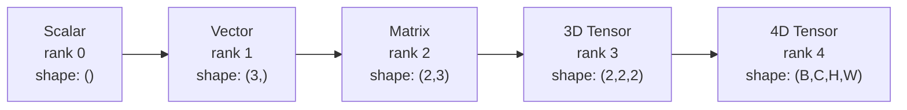
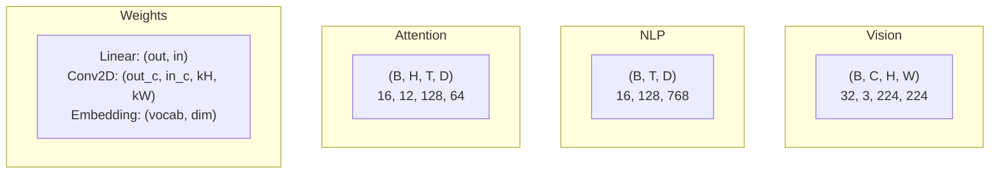
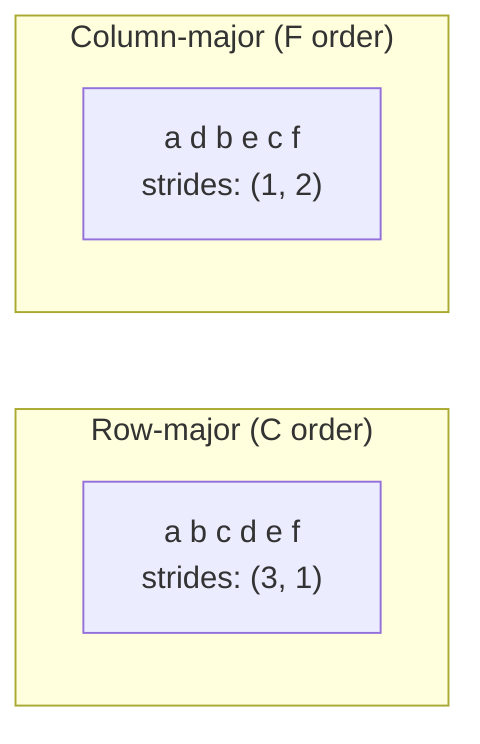
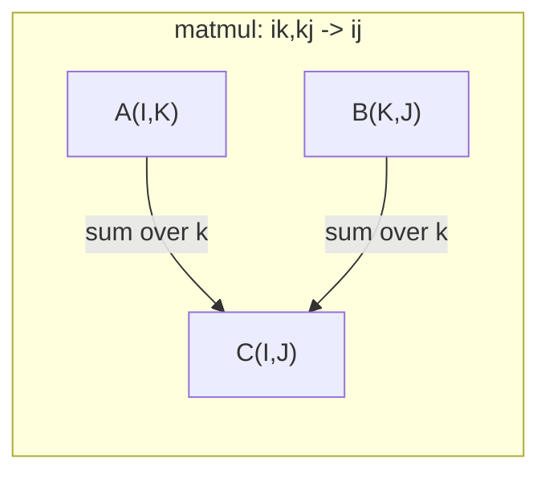

# 张量运算

> 张量是数据与深度学习之间的共同语言。每一张图像、每一个句子、每一条梯度都从它们中间流过。

**类型:** Build
**语言:** Python
**先修:** Phase 1, Lessons 01 (Linear Algebra Intuition), 02 (Vectors, Matrices & Operations)
**时长:** ~90 分钟

## 学习目标

- 从零实现一个张量类，包含 shape、strides、reshape、transpose 和逐元素运算
- 应用广播规则（broadcasting），在不复制数据的前提下对不同形状的张量做运算
- 写出 einsum 表达式，完成点积、矩阵乘法、外积和批量运算
- 追踪多头注意力每一步的精确张量形状

## 问题

你在搭一个 transformer。前向传播看起来很干净。你跑起来得到：`RuntimeError: mat1 and mat2 shapes cannot be multiplied (32x768 and 512x768)`。你盯着形状看。试了个 transpose。现在它说 `Expected 4D input (got 3D input)`。你加了个 unsqueeze。又坏了别的地方。

形状错误是深度学习代码里最常见的 bug。概念上并不难——每个运算都有一个形状契约——但它们会快速增殖。一个 transformer 有几十个 reshape、transpose 和 broadcast 串在一起。一个轴搞错，错误就会级联。更糟的是，有些形状错误根本不会抛异常。它们沿着错误的维度广播、或在错误的轴上求和，静默地产出垃圾。

矩阵处理两组事物之间的成对关系。真实数据塞不进二维。一批 32 张 224x224 的 RGB 图像是 4D 张量：`(32, 3, 224, 224)`。12 个头的自注意力也是 4D：`(batch, heads, seq_len, head_dim)`。你需要一种能推广到任意维度的数据结构，以及能在所有维度上干净组合的运算。这个结构就是张量。掌握它的运算，形状错误就变得琐碎可调试。

## 概念

### 张量是什么

张量是具有统一数据类型的多维数字数组。维度数是**秩**（**rank**，或**阶**）。每个维度是一个**轴**（axis）。**形状**（shape）是沿每个轴大小的元组。



总元素数 = 所有大小的乘积。形状 `(2, 3, 4)` 容纳 `2 * 3 * 4 = 24` 个元素。

### 深度学习中的张量形状

不同数据类型按约定映射到特定的张量形状。



PyTorch 用 NCHW（通道在前）。TensorFlow 默认 NHWC（通道在后）。布局不匹配会导致静默的性能下降或报错。

### 内存布局如何工作

内存中的 2D 数组是 1 维字节序列。**步长**（strides）告诉你沿每个轴前进一步需要跳过多少个元素。



Transpose 不搬动数据。它交换步长，使张量变成**非连续**（non-contiguous）的——一行的元素在内存中不再相邻。

### 广播规则

广播让你在不复制数据的前提下对不同形状的张量做运算。从右对齐形状。两个维度在相等或其中一个为 1 时兼容。维度更少的一方在左侧用 1 填充。

```
Tensor A:     (8, 1, 6, 1)
Tensor B:        (7, 1, 5)
Padded B:     (1, 7, 1, 5)
Result:       (8, 7, 6, 5)
```

### Einsum：通用张量运算

爱因斯坦求和给每个轴标一个字母。在输入中但不在输出中的轴被求和。两边都有的轴被保留。



关键模式：`i,i->` (dot product), `i,j->ij` (outer product), `ii->` (trace), `ij->ji` (transpose), `bij,bjk->bik` (batch matmul), `bhtd,bhsd->bhts` (attention scores)。

```figure
tensor-broadcast
```

## 动手做

代码在 `code/tensors.py`。每一步都引用那里的实现。

### 步骤 1：张量存储与步长

张量存储一个扁平的数字列表加形状元数据。步长告诉索引逻辑如何把多维索引映射到扁平位置。

```python
class Tensor:
    def __init__(self, data, shape=None):
        if isinstance(data, (list, tuple)):
            self._data, self._shape = self._flatten_nested(data)
        elif isinstance(data, np.ndarray):
            self._data = data.flatten().tolist()
            self._shape = tuple(data.shape)
        else:
            self._data = [data]
            self._shape = ()

        if shape is not None:
            total = reduce(lambda a, b: a * b, shape, 1)
            if total != len(self._data):
                raise ValueError(
                    f"Cannot reshape {len(self._data)} elements into shape {shape}"
                )
            self._shape = tuple(shape)

        self._strides = self._compute_strides(self._shape)

    @staticmethod
    def _compute_strides(shape):
        if len(shape) == 0:
            return ()
        strides = [1] * len(shape)
        for i in range(len(shape) - 2, -1, -1):
            strides[i] = strides[i + 1] * shape[i + 1]
        return tuple(strides)
```

对形状 `(3, 4)`，步长是 `(4, 1)`——前进一行跳过 4 个元素，前进一列跳过 1 个元素。

### 步骤 2：Reshape、squeeze、unsqueeze

Reshape 改变形状但不改变元素顺序。元素总数必须保持不变。对其中一个维度用 `-1` 可以推断其大小。

```python
t = Tensor(list(range(12)), shape=(2, 6))
r = t.reshape((3, 4))
r = t.reshape((-1, 3))
```

Squeeze 移除大小为 1 的轴。Unsqueeze 插入一个。Unsqueezing 对广播至关重要——把偏置向量 `(D,)` 加到批量 `(B, T, D)` 上需要 unsqueeze 成 `(1, 1, D)`。

```python
t = Tensor(list(range(6)), shape=(1, 3, 1, 2))
s = t.squeeze()
v = Tensor([1, 2, 3])
u = v.unsqueeze(0)
```

### 步骤 3：Transpose 与 permute

Transpose 交换两个轴。Permute 重排所有轴。这就是你在 NCHW 和 NHWC 之间转换的方式。

```python
mat = Tensor(list(range(6)), shape=(2, 3))
tr = mat.transpose(0, 1)

t4d = Tensor(list(range(24)), shape=(1, 2, 3, 4))
perm = t4d.permute((0, 2, 3, 1))
```

transpose 或 permute 之后，张量在内存中是非连续的。在 PyTorch 中，`view` 在非连续张量上会失败——用 `reshape` 或先调用 `.contiguous()`。

### 步骤 4：逐元素运算与归约

逐元素运算（add, multiply, subtract）独立地作用于每个元素并保持形状。归约（reductions，如 sum, mean, max）折叠一个或多个轴。

```python
a = Tensor([[1, 2], [3, 4]])
b = Tensor([[10, 20], [30, 40]])
c = a + b
d = a * 2
s = a.sum(axis=0)
```

CNN 中的全局平均池化：`(B, C, H, W).mean(axis=[2, 3])` 产生 `(B, C)`。NLP 中的序列平均池化：`(B, T, D).mean(axis=1)` 产生 `(B, D)`。

### 步骤 5：用 NumPy 做广播

`tensors.py` 中的 `demo_broadcasting_numpy()` 函数展示了核心模式。

```python
activations = np.random.randn(4, 3)
bias = np.array([0.1, 0.2, 0.3])
result = activations + bias

images = np.random.randn(2, 3, 4, 4)
scale = np.array([0.5, 1.0, 1.5]).reshape(1, 3, 1, 1)
result = images * scale

a = np.array([1, 2, 3]).reshape(-1, 1)
b = np.array([10, 20, 30, 40]).reshape(1, -1)
outer = a * b
```

通过广播求成对距离：把 `(M, 2)` reshape 成 `(M, 1, 2)`，把 `(N, 2)` reshape 成 `(1, N, 2)`，相减、平方、沿最后一轴求和、开平方根。结果：`(M, N)`。

### 步骤 6：Einsum 运算

`demo_einsum()` 和 `demo_einsum_gallery()` 函数走遍每一个常见模式。

```python
a = np.array([1.0, 2.0, 3.0])
b = np.array([4.0, 5.0, 6.0])
dot = np.einsum("i,i->", a, b)

A = np.array([[1, 2], [3, 4], [5, 6]], dtype=float)
B = np.array([[7, 8, 9], [10, 11, 12]], dtype=float)
matmul = np.einsum("ik,kj->ij", A, B)

batch_A = np.random.randn(4, 3, 5)
batch_B = np.random.randn(4, 5, 2)
batch_mm = np.einsum("bij,bjk->bik", batch_A, batch_B)
```

一次缩并的计算代价是所有索引大小的乘积（保留的和求和的都算）。对 `bij,bjk->bik`，B=32, I=128, J=64, K=128：`32 * 128 * 64 * 128 = 33,554,432` 次乘加。

### 步骤 7：用 einsum 实现注意力机制

`demo_attention_einsum()` 函数端到端实现多头注意力。

```python
B, H, T, D = 2, 4, 8, 16
E = H * D

X = np.random.randn(B, T, E)
W_q = np.random.randn(E, E) * 0.02

Q = np.einsum("bte,ek->btk", X, W_q)
Q = Q.reshape(B, T, H, D).transpose(0, 2, 1, 3)

scores = np.einsum("bhtd,bhsd->bhts", Q, K) / np.sqrt(D)
weights = softmax(scores, axis=-1)
attn_output = np.einsum("bhts,bhsd->bhtd", weights, V)

concat = attn_output.transpose(0, 2, 1, 3).reshape(B, T, E)
output = np.einsum("bte,ek->btk", concat, W_o)
```

每一步都是张量运算：投影（einsum 矩阵乘）、头拆分（reshape + transpose）、注意力分数（einsum 批量矩阵乘）、加权和（einsum 批量矩阵乘）、头合并（transpose + reshape）、输出投影（einsum 矩阵乘）。

## 用起来

### 从零实现 vs NumPy

| Operation | Scratch (Tensor class) | NumPy |
|---|---|---|
| Create | `Tensor([[1,2],[3,4]])` | `np.array([[1,2],[3,4]])` |
| Reshape | `t.reshape((3,4))` | `a.reshape(3,4)` |
| Transpose | `t.transpose(0,1)` | `a.T` or `a.transpose(0,1)` |
| Squeeze | `t.squeeze(0)` | `np.squeeze(a, 0)` |
| Sum | `t.sum(axis=0)` | `a.sum(axis=0)` |
| Einsum | N/A | `np.einsum("ij,jk->ik", a, b)` |

### 从零实现 vs PyTorch

```python
import torch

t = torch.tensor([[1, 2, 3], [4, 5, 6]], dtype=torch.float32)
t.shape
t.stride()
t.is_contiguous()

t.reshape(3, 2)
t.unsqueeze(0)
t.transpose(0, 1)
t.transpose(0, 1).contiguous()

torch.einsum("ik,kj->ij", A, B)
```

PyTorch 增加了 autograd、GPU 支持和优化过的 BLAS kernel。形状语义完全相同。如果你理解了从零实现的版本，PyTorch 的形状错误就变得可读了。

### 每个神经网络层都是一个张量运算

| Operation | Tensor Form | Einsum |
|---|---|---|
| Linear layer | `Y = X @ W.T + b` | `"bd,od->bo"` + bias |
| Attention QKV | `Q = X @ W_q` | `"btd,dh->bth"` |
| Attention scores | `Q @ K.T / sqrt(d)` | `"bhtd,bhsd->bhts"` |
| Attention output | `softmax(scores) @ V` | `"bhts,bhsd->bhtd"` |
| Batch norm | `(X - mu) / sigma * gamma` | element-wise + broadcast |
| Softmax | `exp(x) / sum(exp(x))` | element-wise + reduction |

## 交付

本课产出两个可复用的提示词：

1. **`outputs/prompt-tensor-shapes.md`** -- 一份系统化调试张量形状不匹配的提示词。包含每个常见运算（matmul, broadcast, cat, Linear, Conv2d, BatchNorm, softmax）的决策表和修复查找表。

2. **`outputs/prompt-tensor-debugger.md`** -- 一份分步调试提示词，当形状错误卡住你时粘贴给任意 AI 助手。把错误信息和张量形状喂给它，拿回确切的修复方案。

## 练习

1. **简单 -- Reshape 往返。** 取一个形状 `(2, 3, 4)` 的张量。把它 reshape 成 `(6, 4)`，再到 `(24,)`，再回到 `(2, 3, 4)`。每一步通过打印扁平数据验证元素顺序被保留。

2. **中等 -- 实现广播。** 给 `Tensor` 类扩展一个 `broadcast_to(shape)` 方法，把大小为 1 的维度扩展以匹配目标形状。然后修改 `_elementwise_op` 在运算前自动广播。用形状 `(3, 1)` 和 `(1, 4)` 产生 `(3, 4)` 来测试。

3. **困难 -- 从零实现 einsum。** 实现一个基本的 `einsum(subscripts, *tensors)` 函数，至少处理：点积 (`i,i->`)、矩阵乘 (`ij,jk->ik`)、外积 (`i,j->ij`) 和转置 (`ij->ji`)。解析下标字符串，识别被缩并的索引，然后遍历所有索引组合。把你的结果与 `np.einsum` 对比。

4. **困难 -- 注意力形状追踪器。** 写一个函数，输入 `batch_size`、`seq_len`、`embed_dim` 和 `num_heads`，打印多头注意力每一步的精确形状：输入、Q/K/V 投影、头拆分、注意力分数、softmax 权重、加权和、头合并、输出投影。与 `demo_attention_einsum()` 的输出核对。

## 关键术语

| 术语 | 人们常说 | 它真正的意思 |
|---|---|---|
| 张量（Tensor） | "维度更多的矩阵" | 具有统一类型和定义好的 shape、strides 与运算的多维数组 |
| 秩（Rank） | "维度数" | 轴的个数。矩阵的秩是 2，不是其矩阵秩（matrix rank） |
| 形状（Shape） | "张量的大小" | 沿每个轴大小的元组。`(2, 3)` 表示 2 行 3 列 |
| 步长（Stride） | "内存如何排布" | 沿每个轴前进一步需要跳过的元素个数 |
| 广播（Broadcasting） | "形状不同时它自己就好了" | 一套严格的规则：从右对齐，维度必须相等或其中一个为 1 |
| 连续（Contiguous） | "张量是正常的" | 元素在内存中按顺序存储，与逻辑布局之间没有空隙或重排 |
| Einsum | "写 matmul 的花哨方式" | 一种通用记号，用一行表达任意张量缩并、外积、迹或转置 |
| View | "和 reshape 一样" | 共享同一内存缓冲区但 shape/stride 元数据不同的张量。在非连续数据上会失败 |
| 缩并（Contraction） | "对一个索引求和" | 张量之间共享的索引被相乘并求和、产生更低秩结果的通用运算 |
| NCHW / NHWC | "PyTorch vs TensorFlow 格式" | 图像张量的内存布局约定。NCHW 把通道放在空间维度之前，NHWC 放在之后 |

## 延伸阅读

- [NumPy Broadcasting](https://numpy.org/doc/stable/user/basics.broadcasting.html) -- 带可视化示例的规范规则
- [PyTorch Tensor Views](https://pytorch.org/docs/stable/tensor_view.html) -- view 何时工作、何时复制
- [einops](https://github.com/arogozhnikov/einops) -- 让张量重塑可读且安全的库
- [The Illustrated Transformer](https://jalammar.github.io/illustrated-transformer/) -- 可视化流经注意力的张量形状
- [Einstein Summation in NumPy](https://numpy.org/doc/stable/reference/generated/numpy.einsum.html) -- 带示例的完整 einsum 文档
