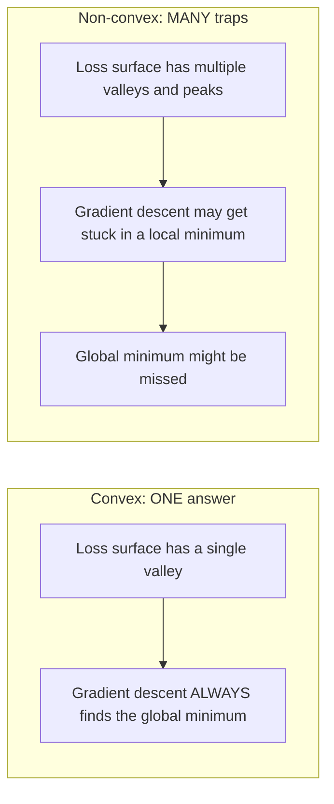
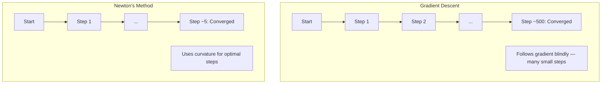
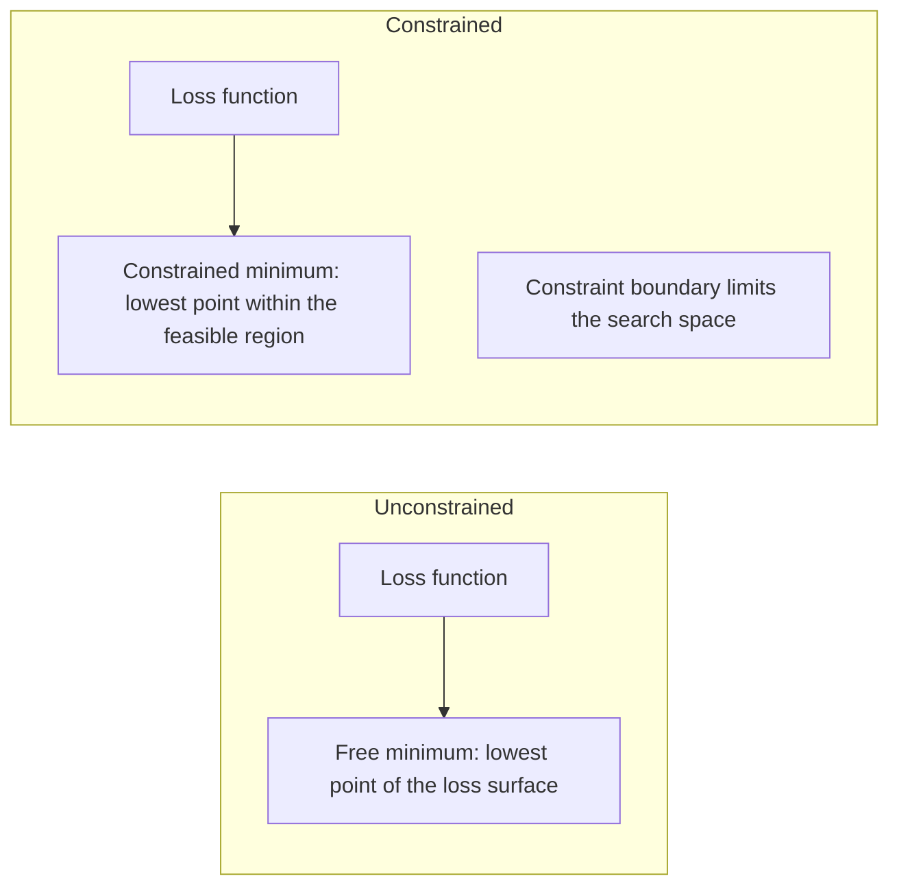
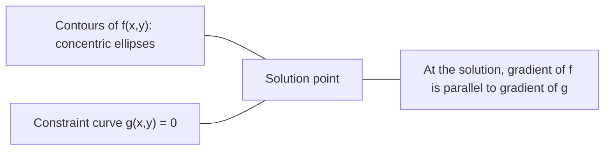

# 凸优化

> 凸问题只有一个谷。神经网络有几百万个。搞清区别很重要。

**类型:** Build
**语言:** Python
**先修:** Phase 1, Lessons 04 (Calculus for ML), 08 (Optimization)
**时长:** ~90 分钟

## 学习目标

- 用定义、二阶导数和 Hessian 判据检验函数是否凸
- 实现牛顿法（Newton's method），并将其二次收敛速度与梯度下降比较
- 用拉格朗日乘子求解约束优化问题，并解读 KKT 条件
- 解释为什么神经网络损失曲面非凸，而 SGD 仍能找到好解

## 问题

第 08 课教你梯度下降、动量和 Adam。这些优化器能在任何曲面上走下坡。但它们不带任何保证。在非凸曲面上做梯度下降可能落到糟糕的局部最小、卡在鞍点，或永远振荡。你还是用了它，因为神经网络是非凸的，没有替代方案。

但机器学习中的许多问题是凸的。线性回归、逻辑回归、SVM、LASSO、岭回归。对这些问题，存在更强的东西：带数学保证的优化。凸问题恰好只有一个谷。任何往下走的算法都会到达全局最小。不需要重启。不需要学习率调度。不需要祈祷。

理解凸性做三件事。第一，它告诉你问题何时容易（凸）何时困难（非凸）。第二，它给你更快的工具，比如凸问题上的牛顿法。第三，它解释了贯穿 ML 的概念：作为约束的正则化、SVM 中的对偶性，以及为什么深度学习尽管违反凸性给你的每一条好性质却仍然有效。

## 概念

### 凸集

如果集合 S 中任意两点之间的线段也完全落在 S 内，则 S 是凸集。

| 凸集 | 非凸 |
|---|---|
| **矩形**：内部任意两点可用完全留在内部的线段连接 | **星形/月牙形**：两个内部点之间的线段可能穿出集合 |
| **三角形**：对所有内部点同样成立 | **圆环/甜甜圈**：洞意味着某些线段离开集合 |
| 任意两点之间的线段留在集合内 | 某些点对之间的线段穿出集合 |

形式化检验：对 S 中任意点 x、y 和 [0, 1] 中任意 t，点 tx + (1-t)y 也在 S 中。

凸集的例子：
- 直线、平面、整个 R^n
- 球（圆、球面、超球）
- 半空间：{x : a^T x <= b}
- 任意多个凸集的交集

非凸集的例子：
- 甜甜圈（圆环）
- 两个不相交圆的并集
- 任何带「凹陷」或「洞」的集合

### 凸函数

如果函数 f 的定义域是凸集，且对定义域中任意两点 x、y 和任意 t ∈ [0, 1]：

```
f(tx + (1-t)y) <= t*f(x) + (1-t)*f(y)
```

几何上：图像上任意两点之间的线段位于图像上方或图像上。

| 性质 | 凸函数 | 非凸函数 |
|---|---|---|
| **线段检验** | 图像上任意两点的连线位于曲线**上方或之上** | 某些点的连线落到曲线**下方** |
| **形状** | 单个向上弯的碗/谷 | 多个峰谷、曲率混杂 |
| **局部最小** | 每个局部最小都是全局最小 | 可能存在高度不同的多个局部最小 |

常见的凸函数：
- f(x) = x^2（抛物线）
- f(x) = |x|（绝对值）
- f(x) = e^x（指数）
- f(x) = max(0, x)（ReLU，虽然是分段线性）
- f(x) = -log(x)，x > 0（负对数）
- 任何线性函数 f(x) = a^T x + b（既凸又凹）

### 检验凸性

三个实用检验，从易到严。

**检验 1：二阶导数检验（一维）。** 若对所有 x 有 f''(x) >= 0，则 f 是凸的。

- f(x) = x^2：f''(x) = 2 >= 0。凸。
- f(x) = x^3：f''(x) = 6x。x < 0 时为负。非凸。
- f(x) = e^x：f''(x) = e^x > 0。凸。

**检验 2：Hessian 检验（多元）。** 若 Hessian 矩阵 H(x) 对所有 x 半正定，则 f 是凸的。Hessian 是二阶偏导数组成的矩阵。

**检验 3：定义检验。** 直接检查不等式 f(tx + (1-t)y) <= t*f(x) + (1-t)*f(y)。对导数难算的函数有用。

### 为什么凸性重要

凸优化的中心定理：

**对凸函数，每个局部最小都是全局最小。**

这意味着梯度下降不会被困住。任何下坡路径都通向同一个答案。算法保证收敛到最优解。



推论：
- 不需要随机重启
- 不需要复杂的学习率调度
- 可以做收敛证明（速率取决于函数性质）
- 解是唯一的（忽略平坦区域）

### ML 中的凸 vs 非凸

| 问题 | 凸吗？ | 原因 |
|---------|---------|-----|
| 线性回归 (MSE) | 是 | 损失对权重是二次的 |
| 逻辑回归 | 是 | 对数损失对权重是凸的 |
| SVM（hinge 损失） | 是 | 线性函数的最大值 |
| LASSO（L1 回归） | 是 | 凸函数之和是凸的 |
| 岭回归（L2） | 是 | 二次 + 二次 = 凸 |
| 神经网络（任意损失） | 否 | 非线性激活造成非凸曲面 |
| k-means 聚类 | 否 | 离散的分配步骤 |
| 矩阵分解 | 否 | 未知量的乘积 |

带凸损失的线性模型是凸的。一旦加入带非线性激活的隐层，凸性就破了。

### Hessian 矩阵

函数 f: R^n -> R 的 Hessian H 是二阶偏导数的 n x n 矩阵。

```
H[i][j] = d^2 f / (dx_i dx_j)
```

对 f(x, y) = x^2 + 3xy + y^2：

```
df/dx = 2x + 3y       d^2f/dx^2 = 2      d^2f/dxdy = 3
df/dy = 3x + 2y       d^2f/dydx = 3      d^2f/dy^2 = 2

H = [ 2  3 ]
    [ 3  2 ]
```

Hessian 告诉你曲率：
- 特征值全正：函数在每个方向都向上弯（该点凸）
- 特征值全负：每个方向都向下弯（凹，局部极大）
- 符号混合：鞍点（某些方向向上弯，某些向下弯）
- 零特征值：该方向平坦（退化）

对凸性，Hessian 必须处处半正定（所有特征值 >= 0），而不只是在某一点。

### 牛顿法

梯度下降用一阶信息（梯度）。牛顿法用二阶信息（Hessian）。它在当前点拟合一个二次近似，直接跳到该二次函数的极小值。

```
Update rule:
  x_new = x - H^(-1) * gradient

Compare to gradient descent:
  x_new = x - lr * gradient
```

牛顿法用逆 Hessian 取代标量学习率。这会根据局部曲率自动调整步长和方向。



优点：
- 在极小值附近二次收敛（误差每步平方）
- 没有要调的学习率
- 尺度不变（与你如何参数化问题无关）

缺点：
- 计算 Hessian 花费 O(n^2) 内存，求逆 O(n^3)
- 对有 100 万权重的神经网络，那是 10^12 个条目和 10^18 次运算
- 对深度学习不实用

### 约束优化

无约束优化：在所有 x 上最小化 f(x)。
约束优化：在约束条件下最小化 f(x)。

真实问题有约束。你想最小化成本，但预算有限。你想最小化误差，但模型复杂度有界。



### 拉格朗日乘子

拉格朗日乘子法把约束问题变成无约束问题。

问题：在 g(x) = 0 约束下最小化 f(x)。

解法：引入新变量（拉格朗日乘子 lambda），求解无约束问题：

```
L(x, lambda) = f(x) + lambda * g(x)
```

在解处，L 的梯度为零：

```
dL/dx = df/dx + lambda * dg/dx = 0
dL/dlambda = g(x) = 0
```

几何直觉：在约束极小值处，f 的梯度必须与约束 g 的梯度平行。若不平行，你可以沿约束曲面移动并进一步减小 f。



例子：在 x + y = 1 约束下最小化 f(x,y) = x^2 + y^2。

```
L = x^2 + y^2 + lambda(x + y - 1)

dL/dx = 2x + lambda = 0  =>  x = -lambda/2
dL/dy = 2y + lambda = 0  =>  y = -lambda/2
dL/dlambda = x + y - 1 = 0

From first two: x = y
Substituting: 2x = 1, so x = y = 0.5, lambda = -1
```

直线 x + y = 1 上离原形最近的点是 (0.5, 0.5)。

### KKT 条件

Karush-Kuhn-Tucker（KKT）条件把拉格朗日乘子推广到不等式约束。

问题：在 g_i(x) <= 0（i = 1, ..., m）约束下最小化 f(x)。

KKT 条件（最优性的必要条件）：

```
1. Stationarity:    df/dx + sum(lambda_i * dg_i/dx) = 0
2. Primal feasibility:  g_i(x) <= 0  for all i
3. Dual feasibility:    lambda_i >= 0  for all i
4. Complementary slackness:  lambda_i * g_i(x) = 0  for all i
```

互补松弛（complementary slackness）是关键洞见：要么约束是活跃的（g_i = 0，解落在边界上），要么乘子为零（约束无关紧要）。不影响解的约束有 lambda = 0。

KKT 条件是 SVM 的核心。支持向量就是约束活跃（lambda > 0）的数据点。所有其他数据点有 lambda = 0，不影响决策边界。

### 作为约束优化的正则化

L1 和 L2 正则化不是任意的技巧。它们是伪装的约束优化问题。

**L2 正则化（Ridge）：**

```
minimize  Loss(w)  subject to  ||w||^2 <= t

Equivalent unconstrained form:
minimize  Loss(w) + lambda * ||w||^2
```

约束 ||w||^2 <= t 定义一个球（二维是圆，三维是球面）。解是损失等高线首次接触这个球的地方。

**L1 正则化（LASSO）：**

```
minimize  Loss(w)  subject to  ||w||_1 <= t

Equivalent unconstrained form:
minimize  Loss(w) + lambda * ||w||_1
```

约束 ||w||_1 <= t 定义一个菱形（二维中是旋转的正方形）。

| 性质 | L2 约束（圆） | L1 约束（菱形） |
|---|---|---|
| **约束形状** | 圆（高维是球） | 菱形（二维中是旋转正方形） |
| **损失等高线相切处** | 光滑边界——圆上任意点 | 角点——与坐标轴对齐 |
| **解的行为** | 权重小但非零 | 某些权重恰好为零（稀疏） |
| **结果** | 权重收缩 | 特征选择 |

这就解释了为什么 L1 产生稀疏模型（特征选择）而 L2 只收缩权重。菱形有与坐标轴对齐的角。损失等高线更可能碰到角，把一个或多个权重恰好设为零。

### 对偶性

每个约束优化问题（原问题）都有一个伴生问题（对偶问题）。对凸问题，原问题和对偶问题有相同的最优值。这就是强对偶（strong duality）。

拉格朗日对偶函数：

```
Primal: minimize f(x) subject to g(x) <= 0
Lagrangian: L(x, lambda) = f(x) + lambda * g(x)
Dual function: d(lambda) = min_x L(x, lambda)
Dual problem: maximize d(lambda) subject to lambda >= 0
```

为什么对偶重要：
- 对偶问题有时比原问题更容易求解
- SVM 在对偶形式下求解，那里问题只依赖数据点之间的点积（从而启用核技巧）
- 对偶给出原问题最优值的下界，可用于检查解的质量

对 SVM 具体而言：

```
Primal: find w, b that maximize the margin 2/||w|| subject to
        y_i(w^T x_i + b) >= 1 for all i

Dual:   maximize sum(alpha_i) - 0.5 * sum_ij(alpha_i * alpha_j * y_i * y_j * x_i^T x_j)
        subject to alpha_i >= 0 and sum(alpha_i * y_i) = 0

The dual only involves dot products x_i^T x_j.
Replace x_i^T x_j with K(x_i, x_j) to get the kernel trick.
```

### 为什么深度学习在非凸下仍然有效

神经网络损失函数极度非凸。按任何经典标准，优化它们都应该失败。然而随机梯度下降却能可靠地找到好解。几个因素解释了这一点。

**大多数局部最小已经够好。** 在高维空间中，随机临界点（梯度为零处）绝大多数是鞍点，不是局部最小。存在的少数局部最小，其损失值往往接近全局最小。当参数空间有数百万维时，陷入糟糕局部最小的可能性极低。

**真正的障碍是鞍点，不是局部最小。** 在有 n 个参数的函数中，鞍点混合了正曲率与负曲率方向。对高维中的随机临界点，全部 n 个特征值为正（局部最小）的概率大约是 2^(-n)。几乎所有临界点都是鞍点。SGD 的噪声帮助逃离它们。

**过参数化让曲面更平滑。** 参数多于训练样本的网络有更平滑、更连通的损失曲面。更宽的网络有更少的坏局部最小。这有违直觉，但经验上一致。

**损失曲面结构：**

| 性质 | 低维空间 | 高维空间 |
|---|---|---|
| **曲面** | 许多孤立的峰和谷 | 平滑连通的谷 |
| **极小值** | 许多孤立局部最小 | 很少坏局部最小；大多接近最优 |
| **导航** | 难以找到全局最小 | 许多路径通向好解 |
| **临界点** | 局部最小与鞍点混合 | 绝大多数是鞍点，不是局部最小 |

**随机噪声充当隐式正则化。** 小批量 SGD 添加的噪声防止落入尖锐极小值。尖锐极小值过拟合；平坦极小值泛化。噪声把优化偏向损失曲面的平坦区域。

### 实践中的二阶方法

纯牛顿法对大模型不实用。几种近似让二阶信息变得可用。

**L-BFGS（有限内存 BFGS）：** 用最近 m 个梯度差近似逆 Hessian。需要 O(mn) 内存而非 O(n^2)。对约 10,000 个参数以内的问题工作良好。用于经典 ML（逻辑回归、CRF），但不用于深度学习。

**自然梯度（Natural gradient）：** 用 Fisher 信息矩阵（对数似然的期望 Hessian）代替标准 Hessian。这考虑了概率分布的几何。K-FAC（Kronecker 分解近似曲率）把 Fisher 矩阵近似为 Kronecker 积，使其对神经网络实用。

**无 Hessian 优化（Hessian-free）：** 用共轭梯度求解 Hx = g，从不显式形成 H。只需要 Hessian-向量积，可通过自动微分在 O(n) 时间内计算。

**对角近似：** Adam 的二阶矩是 Hessian 对角的对角近似。AdaHessian 通过 Hutchinson 估计量使用实际 Hessian 对角元素来扩展这一点。

| 方法 | 内存 | 每步代价 | 何时使用 |
|--------|--------|--------------|-------------|
| 梯度下降 | O(n) | O(n) | 基线、大模型 |
| 牛顿法 | O(n^2) | O(n^3) | 小型凸问题 |
| L-BFGS | O(mn) | O(mn) | 中型凸问题 |
| Adam | O(n) | O(n) | 深度学习默认 |
| K-FAC | O(n) | 每层 O(n) | 研究、大批量训练 |

```figure
convex-vs-nonconvex
```

## 动手做

### 步骤 1：凸性检查器

构建一个通过采样点并检查定义来实证检验凸性的函数。

```python
import random
import math

def check_convexity(f, dim, bounds=(-5, 5), samples=1000):
    violations = 0
    for _ in range(samples):
        x = [random.uniform(*bounds) for _ in range(dim)]
        y = [random.uniform(*bounds) for _ in range(dim)]
        t = random.uniform(0, 1)
        mid = [t * xi + (1 - t) * yi for xi, yi in zip(x, y)]
        lhs = f(mid)
        rhs = t * f(x) + (1 - t) * f(y)
        if lhs > rhs + 1e-10:
            violations += 1
    return violations == 0, violations
```

### 步骤 2：二维牛顿法

用显式 Hessian 实现牛顿法。与梯度下降比较收敛速度。

```python
def newtons_method(f, grad_f, hessian_f, x0, steps=50, tol=1e-12):
    x = list(x0)
    history = [x[:]]
    for _ in range(steps):
        g = grad_f(x)
        H = hessian_f(x)
        det = H[0][0] * H[1][1] - H[0][1] * H[1][0]
        if abs(det) < 1e-15:
            break
        H_inv = [
            [H[1][1] / det, -H[0][1] / det],
            [-H[1][0] / det, H[0][0] / det],
        ]
        dx = [
            H_inv[0][0] * g[0] + H_inv[0][1] * g[1],
            H_inv[1][0] * g[0] + H_inv[1][1] * g[1],
        ]
        x = [x[0] - dx[0], x[1] - dx[1]]
        history.append(x[:])
        if sum(gi ** 2 for gi in g) < tol:
            break
    return history
```

### 步骤 3：拉格朗日乘子求解器

用拉格朗日函数上的梯度下降求解约束优化。

```python
def lagrange_solve(f_grad, g_val, g_grad, x0, lr=0.01,
                   lr_lambda=0.01, steps=5000):
    x = list(x0)
    lam = 0.0
    history = []
    for _ in range(steps):
        fg = f_grad(x)
        gv = g_val(x)
        gg = g_grad(x)
        x = [
            xi - lr * (fgi + lam * ggi)
            for xi, fgi, ggi in zip(x, fg, gg)
        ]
        lam = lam + lr_lambda * gv
        history.append((x[:], lam, gv))
    return history
```

### 步骤 4：比较一阶与二阶

在同一个二次函数上运行梯度下降和牛顿法。数一数收敛需要的步数。

```python
def quadratic(x):
    return 5 * x[0] ** 2 + x[1] ** 2

def quadratic_grad(x):
    return [10 * x[0], 2 * x[1]]

def quadratic_hessian(x):
    return [[10, 0], [0, 2]]
```

牛顿法会在 1 步内收敛（对二次函数是精确的）。梯度下降需要数百步，因为 Hessian 的特征值相差 5 倍，形成狭长的谷。

## 用起来

选择 ML 模型与求解器时，凸性分析可直接应用。

对凸问题（逻辑回归、SVM、LASSO）：
- 用专门的求解器（liblinear、CVXPY、scipy.optimize.minimize with method='L-BFGS-B'）
- 期望唯一的全局解
- 二阶方法实用且快

对非凸问题（神经网络）：
- 用一阶方法（SGD、Adam）
- 接受解依赖初始化和随机性
- 把过参数化、噪声和学习率调度当作隐式正则化
- 不要浪费时间搜寻全局最小。一个好局部最小就够了。

```python
from scipy.optimize import minimize

result = minimize(
    fun=lambda w: sum((y - X @ w) ** 2) + 0.1 * sum(w ** 2),
    x0=np.zeros(d),
    method='L-BFGS-B',
    jac=lambda w: -2 * X.T @ (y - X @ w) + 0.2 * w,
)
```

对 SVM，对偶形式让你能用核技巧：

```python
from sklearn.svm import SVC

svm = SVC(kernel='rbf', C=1.0)
svm.fit(X_train, y_train)
print(f"Support vectors: {svm.n_support_}")
```

## 练习

1. **凸性画廊。** 用检查器检验这些函数的凸性：f(x) = x^4、f(x) = sin(x)、f(x,y) = x^2 + y^2、f(x,y) = x*y、f(x) = max(x, 0)。解释每个结果为何合理。

2. **牛顿 vs 梯度下降赛跑。** 两种方法在 f(x,y) = 50*x^2 + y^2 上从起点 (10, 10) 出发。各自需要多少步达到 loss < 1e-10？当条件数（Hessian 最大与最小特征值之比）增大时，梯度下降会怎样？

3. **拉格朗日乘子几何。** 在 x + 2y = 4 约束下最小化 f(x,y) = (x-3)^2 + (y-3)^2。通过检查解处 f 的梯度与 g 的梯度平行来验证解。

4. **正则化约束。** 实现 L1 约束优化：在 |x| + |y| <= 1 约束下最小化 (x-3)^2 + (y-2)^2。展示解有一个坐标等于零（菱形约束带来的稀疏性）。

5. **Hessian 特征值分析。** 计算 Rosenbrock 函数在 (1,1) 和 (-1,1) 处的 Hessian。计算两点处的特征值。特征值告诉你极小值处与远离极小值处的曲率有何不同？

## 关键术语

| 术语 | 含义 |
|------|---------------|
| 凸集（Convex set） | 集合内任意两点之间的线段都留在集合内的集合 |
| 凸函数（Convex function） | 图像上任意两点的连线位于图像上方或之上的函数。等价地，Hessian 处处半正定 |
| 局部最小（Local minimum） | 比附近所有点都低的点。对凸函数，每个局部最小都是全局最小 |
| 全局最小（Global minimum） | 函数在整个定义域上的最低点 |
| Hessian 矩阵 | 所有二阶偏导数组成的矩阵。编码曲率信息 |
| 半正定（Positive semidefinite） | 特征值全为非负的矩阵。「二阶导数 >= 0」的多维对应物 |
| 条件数（Condition number） | Hessian 最大与最小特征值之比。高条件数意味着狭长的谷和缓慢的梯度下降 |
| 牛顿法（Newton's method） | 用逆 Hessian 决定步长方向与大小的二阶优化器。极小值附近二次收敛 |
| 拉格朗日乘子（Lagrange multiplier） | 为把约束优化问题转化为无约束问题而引入的变量 |
| KKT 条件 | 带不等式约束的最优性必要条件。推广拉格朗日乘子 |
| 互补松弛（Complementary slackness） | 在解处，约束要么活跃，要么其乘子为零。绝不会两者都非零 |
| 对偶性（Duality） | 每个约束问题都有伴生的对偶问题。对凸问题，两者最优值相同 |
| 强对偶（Strong duality） | 原问题与对偶问题最优值相等。对满足 Slater 条件的凸问题成立 |
| L-BFGS | 近似二阶方法，存储最近 m 个梯度差而非完整 Hessian |
| 鞍点（Saddle point） | 梯度为零，但在某些方向是极小、另一些方向是极大的点 |
| 过参数化（Overparameterization） | 使用比训练样本更多的参数。平滑损失曲面并减少坏局部最小 |

## 延伸阅读

- [Boyd & Vandenberghe: Convex Optimization](https://web.stanford.edu/~boyd/cvxbook/) - 标准教材，可在线免费获取
- [Bottou, Curtis, Nocedal: Optimization Methods for Large-Scale Machine Learning (2018)](https://arxiv.org/abs/1606.04838) - 连接凸优化理论与深度学习实践
- [Choromanska et al.: The Loss Surfaces of Multilayer Networks (2015)](https://arxiv.org/abs/1412.0233) - 为什么非凸神经网络曲面并不像看起来那么糟
- [Nocedal & Wright: Numerical Optimization](https://link.springer.com/book/10.1007/978-0-387-40065-5) - 牛顿法、L-BFGS 与约束优化的全面参考
