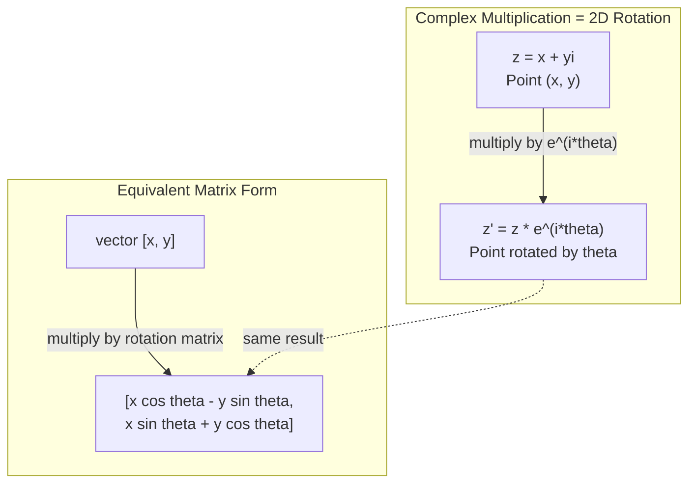
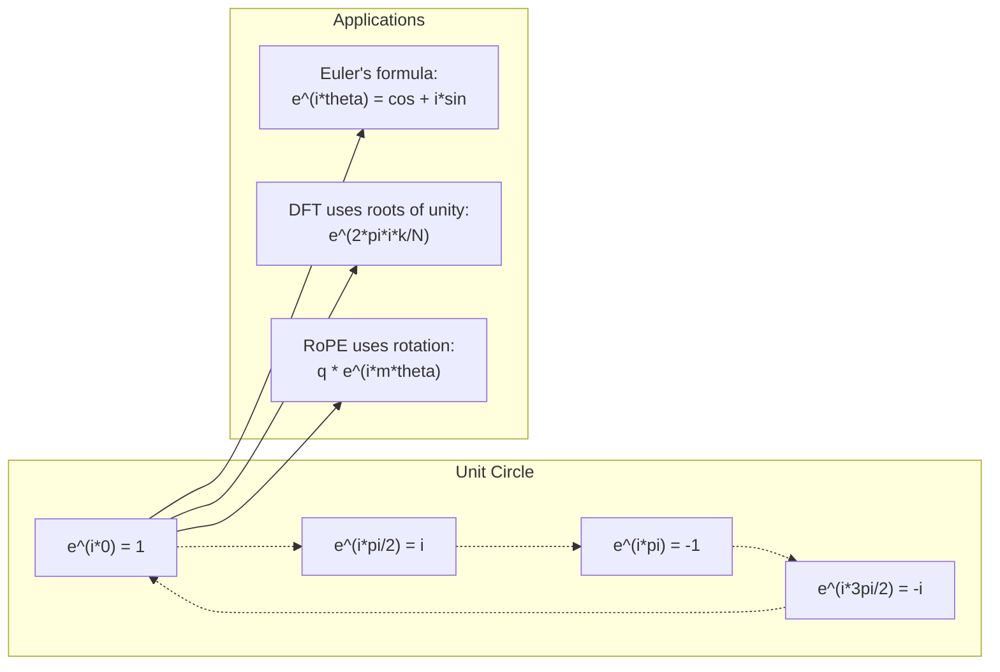

# 复数

> -1 的平方根并不虚幻。它是旋转、频率以及半个信号处理领域的钥匙。

**类型:** Learn
**语言:** Python
**先修:** Phase 1, Lessons 01-04（线性代数、微积分）
**时长:** ~60 分钟

## 学习目标

- 在直角坐标与极坐标两种形式下完成复数运算（加、乘、除、共轭）
- 运用欧拉公式在复指数与三角函数之间互相转换
- 用复单位根从零实现离散傅里叶变换
- 解释复数旋转如何支撑 Transformer 中的 RoPE 与正弦位置编码

## 问题

翻开一篇傅里叶变换的论文，满篇都是 `i`。看 Transformer 的位置编码，会看到不同频率的 `sin` 与 `cos`——那正是复指数的实部与虚部。读量子计算，会发现一切都被写在复向量空间里。

复数看起来很抽象。建立在 -1 平方根上的数系，像是一种数学把戏。但它不是把戏。它是旋转与振荡的自然语言。每当有什么东西在旋转、振动或振荡，复数就是正确的工具。

不理解复数，你就无法理解离散傅里叶变换，无法理解 FFT，无法理解现代语言模型中 RoPE（旋转位置编码）的工作方式，也无法理解原始 Transformer 论文中的正弦位置编码为何采用那些频率。

本课从零搭建复数运算，把它接到几何上，并指出复数在机器学习中究竟出现在哪里。

## 概念

### 什么是复数？

复数有两部分：实部与虚部。

```
z = a + bi

where:
  a is the real part
  b is the imaginary part
  i is the imaginary unit, defined by i^2 = -1
```

就这样。你把数轴扩展成一个平面。实数在一条轴上，虚数在另一条轴上。每个复数都是这个平面中的一个点。

### 复数运算

**加法。** 实部加实部，虚部加虚部。

```
(a + bi) + (c + di) = (a + c) + (b + d)i

Example: (3 + 2i) + (1 + 4i) = 4 + 6i
```

**乘法。** 用分配律，并记住 i^2 = -1。

```
(a + bi)(c + di) = ac + adi + bci + bdi^2
                 = ac + adi + bci - bd
                 = (ac - bd) + (ad + bc)i

Example: (3 + 2i)(1 + 4i) = 3 + 12i + 2i + 8i^2
                            = 3 + 14i - 8
                            = -5 + 14i
```

**共轭。** 把虚部的符号翻过来。

```
conjugate of (a + bi) = a - bi
```

一个复数与其共轭的乘积永远是实数：

```
(a + bi)(a - bi) = a^2 + b^2
```

**除法。** 分子分母同乘分母的共轭。

```
(a + bi) / (c + di) = (a + bi)(c - di) / (c^2 + d^2)
```

这样分母中的虚部被消掉，得到一个干净的复数。

### 复平面

复平面把每个复数映射为二维点。水平轴是实轴，垂直轴是虚轴。

```
z = 3 + 2i  corresponds to the point (3, 2)
z = -1 + 0i corresponds to the point (-1, 0) on the real axis
z = 0 + 4i  corresponds to the point (0, 4) on the imaginary axis
```

一个复数同时是一个点，也是从原点出发的向量。正是这种双重解读，让复数在几何上如此有用。

### 极坐标形式

平面上任意一点都可以用它到原点的距离以及与正实轴的夹角来描述。

```
z = r * (cos(theta) + i*sin(theta))

where:
  r = |z| = sqrt(a^2 + b^2)     (magnitude, or modulus)
  theta = atan2(b, a)             (phase, or argument)
```

直角坐标形式（a + bi）适合加法。极坐标形式（r, theta）适合乘法。

**极坐标下的乘法。** 模长相乘，角度相加。

```
z1 = r1 * e^(i*theta1)
z2 = r2 * e^(i*theta2)

z1 * z2 = (r1 * r2) * e^(i*(theta1 + theta2))
```

这就是复数为何完美适配旋转。乘以一个模长为 1 的复数，就是一次纯旋转。

### 欧拉公式

连接复指数与三角学的桥梁：

```
e^(i*theta) = cos(theta) + i*sin(theta)
```

这是本课最重要的公式。当 theta = pi 时：

```
e^(i*pi) = cos(pi) + i*sin(pi) = -1 + 0i = -1

Therefore: e^(i*pi) + 1 = 0
```

五个基本常数（e、i、pi、1、0）被一个等式串在一起。

### 欧拉公式为何对 ML 重要

欧拉公式说明：随着 theta 变化，`e^(i*theta)` 会描出单位圆。theta = 0 时你在 (1, 0)；theta = pi/2 时你在 (0, 1)；theta = pi 时你在 (-1, 0)；theta = 3*pi/2 时你在 (0, -1)。转满一圈是 theta = 2*pi。

这意味着复指数就是旋转。而旋转在信号处理和 ML 里无处不在。

### 与二维旋转的关系

把复数 (x + yi) 乘以 e^(i*theta)，就是把点 (x, y) 绕原点旋转角度 theta。

```
Rotation via complex multiplication:
  (x + yi) * (cos(theta) + i*sin(theta))
  = (x*cos(theta) - y*sin(theta)) + (x*sin(theta) + y*cos(theta))i

Rotation via matrix multiplication:
  [cos(theta)  -sin(theta)] [x]   [x*cos(theta) - y*sin(theta)]
  [sin(theta)   cos(theta)] [y] = [x*sin(theta) + y*cos(theta)]
```

两者结果完全一致。复数乘法就是二维旋转。旋转矩阵不过是用矩阵记号写出来的复数乘法。



### 相量与旋转信号

复指数 e^(i*omega*t) 是一个以角频率 omega 绕单位圆旋转的点。随着 t 增大，这个点描出圆周。

这个旋转点的实部是 cos(omega*t)，虚部是 sin(omega*t)。正弦信号就是旋转复数的影子。

```
e^(i*omega*t) = cos(omega*t) + i*sin(omega*t)

Real part:      cos(omega*t)    -- a cosine wave
Imaginary part: sin(omega*t)    -- a sine wave
```

这就是相量表示。你不再追踪一条扭来扭去的正弦曲线，而是追踪一支平滑旋转的箭头。相移变成角度偏移，幅度变化变成模长变化，信号相加变成向量相加。

### 单位根

N 次单位根是单位圆上均匀分布的 N 个点：

```
w_k = e^(2*pi*i*k/N)    for k = 0, 1, 2, ..., N-1
```

N = 4 时，这些根是：1、i、-1、-i（罗盘上的四个方向）。
N = 8 时，你会得到这四个方向再加上四条对角线。

单位根是离散傅里叶变换的基础。DFT 把信号分解到这 N 个等间隔频率上的分量。

### 与 DFT 的联系

信号 x[0], x[1], ..., x[N-1] 的离散傅里叶变换是：

```
X[k] = sum_{n=0}^{N-1} x[n] * e^(-2*pi*i*k*n/N)
```

每个 X[k] 衡量的是信号与第 k 个单位根——也就是频率 k 上的复正弦——之间的相关程度。DFT 把信号拆成 N 个旋转相量，并告诉你每一个的幅度与相位。

### 为什么 i 并不"虚"

"虚数"这个词是个历史误会。笛卡尔用它来贬低。但 i 并不比当年人们拒绝负数时的负数更"虚"。负数回答的是"3 减去什么等于 5？"这样的问题；虚数单位回答的是"什么的平方等于 -1？"。

更有用的说法是：i 是一个 90 度旋转算子。把一个实数乘一次 i，你旋转 90 度到虚轴；再乘一次 i（i^2），又旋转 90 度——现在你指向负实方向。这就是 i^2 = -1 的原因。它不神秘。它是两次四分之一圈组成的一个半圈。

这就是复数在工程中无处不在的原因。任何在旋转的东西——电磁波、量子态、信号振荡、位置编码——都天然由复数描述。

### 复指数与三角函数

在欧拉公式之前，工程师把信号写成 A*cos(omega*t + phi)——幅度 A、频率 omega、相位 phi。这能用，但算起来很痛苦。把两个不同相位的余弦相加，需要动用三角恒等式。

用复指数，同一个信号就是 A*e^(i*(omega*t + phi))。两个信号相加就是两个复数相加。调制（相乘）就是模长相乘、角度相加。相移变成角度相加，频移变成乘以某个相量。

整个信号处理领域都转向了复指数记号，因为数学更干净。"实信号"永远只是复表示的实部。虚部作为记账信息一路携带，让所有代数自然成立。

### 与 Transformer 的联系

**正弦位置编码**（原始 Transformer 论文）：

```
PE(pos, 2i) = sin(pos / 10000^(2i/d))
PE(pos, 2i+1) = cos(pos / 10000^(2i/d))
```

sin 与 cos 这一对，就是不同频率下复指数的实部与虚部。每个频率为位置编码提供不同的"分辨率"。低频变化慢（粗粒度位置），高频变化快（细粒度位置）。它们合在一起，给每个位置一个唯一的频率指纹。

**RoPE（旋转位置编码）** 走得更远。它显式地把 query 和 key 向量乘以复旋转矩阵。两个 token 之间的相对位置变成一个旋转角。注意力用这些旋转向量计算，模型便通过复数乘法感知相对位置。

| 运算 | 代数形式 | 几何含义 |
|-----------|---------------|-------------------|
| 加法 | (a+c) + (b+d)i | 平面上的向量加法 |
| 乘法 | (ac-bd) + (ad+bc)i | 旋转并缩放 |
| 共轭 | a - bi | 关于实轴反射 |
| 模长 | sqrt(a^2 + b^2) | 到原点的距离 |
| 相位 | atan2(b, a) | 与正实轴的夹角 |
| 除法 | 乘以共轭 | 反向旋转并重新缩放 |
| 幂 | r^n * e^(i*n*theta) | 旋转 n 次，缩放 r^n 倍 |



```figure
roots-of-unity
```

## 动手做

### 步骤 1：复数类

构建一个复数类，支持四则运算、模长、相位，以及直角坐标与极坐标之间的转换。

```python
import math

class Complex:
    def __init__(self, real, imag=0.0):
        self.real = real
        self.imag = imag

    def __add__(self, other):
        return Complex(self.real + other.real, self.imag + other.imag)

    def __mul__(self, other):
        r = self.real * other.real - self.imag * other.imag
        i = self.real * other.imag + self.imag * other.real
        return Complex(r, i)

    def __truediv__(self, other):
        denom = other.real ** 2 + other.imag ** 2
        r = (self.real * other.real + self.imag * other.imag) / denom
        i = (self.imag * other.real - self.real * other.imag) / denom
        return Complex(r, i)

    def magnitude(self):
        return math.sqrt(self.real ** 2 + self.imag ** 2)

    def phase(self):
        return math.atan2(self.imag, self.real)

    def conjugate(self):
        return Complex(self.real, -self.imag)
```

### 步骤 2：极坐标转换与欧拉公式

```python
def to_polar(z):
    return z.magnitude(), z.phase()

def from_polar(r, theta):
    return Complex(r * math.cos(theta), r * math.sin(theta))

def euler(theta):
    return Complex(math.cos(theta), math.sin(theta))
```

验证：`euler(theta).magnitude()` 应始终为 1.0。`euler(0)` 应给出 (1, 0)。`euler(pi)` 应给出 (-1, 0)。

### 步骤 3：旋转

把点 (x, y) 旋转角度 theta，就是一次复数乘法：

```python
point = Complex(3, 4)
rotated = point * euler(math.pi / 4)
```

模长保持不变，只有角度变了。

### 步骤 4：用复数运算实现 DFT

```python
def dft(signal):
    N = len(signal)
    result = []
    for k in range(N):
        total = Complex(0, 0)
        for n in range(N):
            angle = -2 * math.pi * k * n / N
            total = total + Complex(signal[n], 0) * euler(angle)
        result.append(total)
    return result
```

这是 O(N^2) 的 DFT。每个输出 X[k] 是信号样本乘以单位根后的总和。

### 步骤 5：逆 DFT

逆 DFT 从频谱重建原始信号。与正向 DFT 相比只有两处不同：指数中的符号取反，并除以 N。

```python
def idft(spectrum):
    N = len(spectrum)
    result = []
    for n in range(N):
        total = Complex(0, 0)
        for k in range(N):
            angle = 2 * math.pi * k * n / N
            total = total + spectrum[k] * euler(angle)
        result.append(Complex(total.real / N, total.imag / N))
    return result
```

这会给你完美重建。先做 DFT，再做 IDFT，你会在机器精度内拿回原始信号。没有任何信息丢失。

### 步骤 6：单位根

```python
def roots_of_unity(N):
    return [euler(2 * math.pi * k / N) for k in range(N)]
```

验证两条性质：
- 每个根的模长恰好为 1。
- 全部 N 个根之和为零（由对称性互相抵消）。

正是这些性质让 DFT 可逆。单位根构成频域的一组正交基。

## 用起来

Python 内置了复数支持。字面量 `j` 表示虚数单位。

```python
z = 3 + 2j
w = 1 + 4j

print(z + w)
print(z * w)
print(abs(z))

import cmath
print(cmath.phase(z))
print(cmath.exp(1j * cmath.pi))
```

对数组来说，numpy 原生处理复数：

```python
import numpy as np

z = np.array([1+2j, 3+4j, 5+6j])
print(np.abs(z))
print(np.angle(z))
print(np.conj(z))
print(np.real(z))
print(np.imag(z))

signal = np.sin(2 * np.pi * 5 * np.linspace(0, 1, 128))
spectrum = np.fft.fft(signal)
freqs = np.fft.fftfreq(128, d=1/128)
```

## 交付

运行 `code/complex_numbers.py` 生成 `outputs/skill-complex-arithmetic.md`。

## 练习

1. **手算复数运算。** 计算 (2 + 3i) * (4 - i) 并用代码验证。再计算 (5 + 2i) / (1 - 3i)。把两个结果画在复平面上，检查乘法确实旋转并缩放了第一个数。

2. **旋转序列。** 从点 (1, 0) 出发，乘以 e^(i*pi/6) 共十二次。验证 12 次乘法之后回到 (1, 0)。打印每一步的坐标，确认它们描出一个正十二边形。

3. **已知信号的 DFT。** 创建一个信号，它是 sin(2*pi*3*t) 与 0.5*sin(2*pi*7*t) 之和，在 32 个点上采样。运行你的 DFT。验证幅度谱在频率 3 和 7 处有峰，且频率 7 处的峰高是频率 3 处的一半。

4. **单位根可视化。** 计算 8 次单位根。验证它们之和为零。验证把任意一个根乘以本原根 e^(2*pi*i/8) 会得到下一个根。

5. **旋转矩阵等价性。** 取 10 个随机角度和 10 个随机点，验证复数乘法与 2x2 旋转矩阵的矩阵向量乘法给出相同结果。打印最大数值误差。

## 关键术语

| 术语 | 含义 |
|------|---------------|
| 复数（Complex number） | 形如 a + bi 的数，其中 a 是实部，b 是虚部，且 i^2 = -1 |
| 虚数单位（Imaginary unit） | 数 i，由 i^2 = -1 定义。并非哲学意义上的"虚"——它是一个旋转算子 |
| 复平面（Complex plane） | x 轴为实轴、y 轴为虚轴的二维平面。也称 Argand 平面 |
| 模长（Magnitude / modulus） | 到原点的距离：sqrt(a^2 + b^2)。记作 \|z\| |
| 相位（Phase / argument） | 与正实轴的夹角：atan2(b, a)。记作 arg(z) |
| 共轭（Conjugate） | 关于实轴的镜像：a + bi 的共轭是 a - bi |
| 极坐标形式（Polar form） | 把 z 写成 r * e^(i*theta) 而非 a + bi。让乘法变容易 |
| 欧拉公式（Euler's formula） | e^(i*theta) = cos(theta) + i*sin(theta)。把指数与三角学连起来 |
| 相量（Phasor） | 表示正弦信号的旋转复数 e^(i*omega*t) |
| 单位根（Roots of unity） | k = 0 到 N-1 的 N 个复数 e^(2*pi*i*k/N)。单位圆上 N 个等分点 |
| DFT | 离散傅里叶变换。用单位根把信号分解为复正弦分量 |
| RoPE | 旋转位置编码。用复数乘法在 Transformer 注意力中编码相对位置 |

## 延伸阅读

- [Visual Introduction to Euler's Formula](https://betterexplained.com/articles/intuitive-understanding-of-eulers-formula/) - 不用厚重记号也能建立几何直觉
- [Su et al.: RoFormer (2021)](https://arxiv.org/abs/2104.09864) - 用复旋转引入旋转位置编码的论文
- [Vaswani et al.: Attention Is All You Need (2017)](https://arxiv.org/abs/1706.03762) - 含正弦位置编码的原始 Transformer 论文
- [3Blue1Brown: Euler's formula with introductory group theory](https://www.youtube.com/watch?v=mvmuCPvRoWQ) - 直观解释 e^(i*pi) = -1
- [Needham: Visual Complex Analysis](https://global.oup.com/academic/product/visual-complex-analysis-9780198534464) - 最好的复数可视化论述，充满几何洞见
- [Strang: Introduction to Linear Algebra, Ch. 10](https://math.mit.edu/~gs/linearalgebra/) - 在线性代数与特征值语境下的复数
