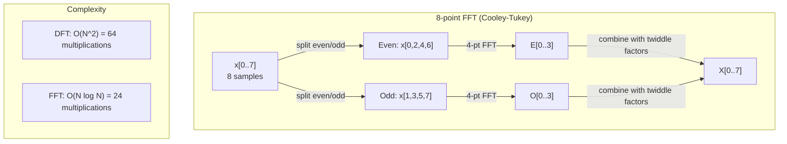
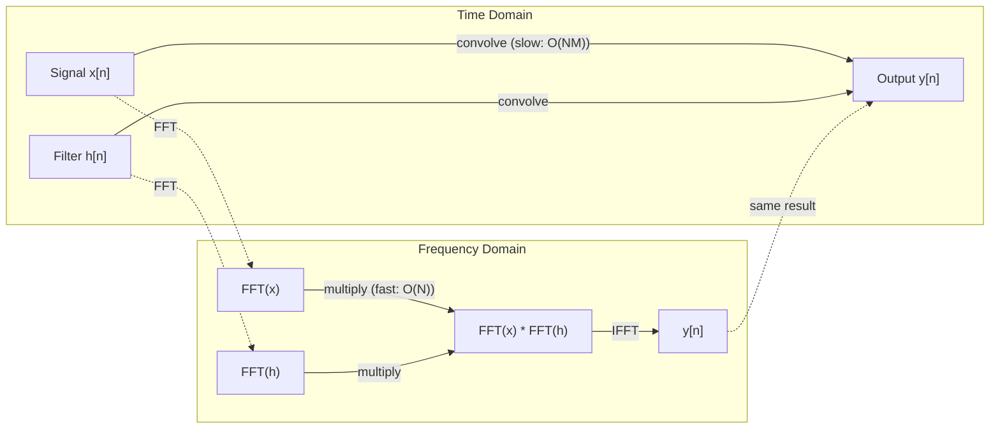

# 傅里叶变换

> 每个信号都是正弦波之和。傅里叶变换告诉你，是哪些正弦波。

**类型:** Build
**语言:** Python
**先修:** Phase 1, Lessons 01-04, 19（复数）
**时长:** ~90 分钟

## 学习目标

- 从零实现 DFT，并与 O(N log N) 的 Cooley-Tukey FFT 对照验证
- 解读频率系数：从信号中提取幅度、相位与功率谱
- 应用卷积定理，通过 FFT 乘法完成卷积
- 把傅里叶频率分解连接到 Transformer 位置编码与 CNN 卷积层

## 问题

一段音频录音是压力随时间变化的测量序列。一个股票价格是数值随天数变化的序列。一张图是像素强度在空间上的网格。这些都是时域（或空域）中的数据。你看到的是数值随某个下标在变化。

但许多模式在时域中是看不见的。这段音频是纯音还是和弦？这个股票价格有没有周周期？这张图有没有重复纹理？这些问题问的是频率成分，而时域把它藏了起来。

傅里叶变换把数据从时域转换到频域。它接收一个信号，把它分解成不同频率的正弦波。每个正弦波有一个幅度（有多强）和一个相位（从哪里开始）。傅里叶变换把两者都告诉你。

这对 ML 很重要，因为频域思维无处不在。卷积神经网络做卷积，而卷积在频域中就是乘法。Transformer 的位置编码用频率分解来表示位置。音频模型（语音识别、音乐生成）处理的是频谱图——声音的频率表示。时间序列模型寻找周期性模式。理解傅里叶变换，就给了你与这一切打交道的词汇。

## 概念

### DFT 的定义

给定 N 个样本 x[0], x[1], ..., x[N-1]，离散傅里叶变换产生 N 个频率系数 X[0], X[1], ..., X[N-1]：

```
X[k] = sum_{n=0}^{N-1} x[n] * e^(-2*pi*i*k*n/N)

for k = 0, 1, ..., N-1
```

每个 X[k] 是一个复数。它的模 |X[k]| 告诉你频率 k 的幅度。它的相位 angle(X[k]) 告诉你该频率的相位偏移。

关键洞见：`e^(-2*pi*i*k*n/N)` 是频率 k 上的旋转相量。DFT 计算的是信号与 N 个等间隔频率各自的相关程度。如果信号在频率 k 处有能量，相关就大；否则就接近零。

### 每个系数的含义

**X[0]：直流分量。** 这是所有样本之和——与均值成正比。它表示信号的常数（零频率）偏移。

```
X[0] = sum_{n=0}^{N-1} x[n] * e^0 = sum of all samples
```

**1 <= k <= N/2 的 X[k]：正频率。** X[k] 表示每 N 个样本 k 个周期的频率。k 越大，频率越高（振荡越快）。

**X[N/2]：奈奎斯特频率。** 用 N 个样本能表示的最高频率。高于此会出现混叠——高频伪装成低频。

**N/2 < k < N 的 X[k]：负频率。** 对实值信号，X[N-k] = conj(X[k])。负频率是正频率的镜像。这就是为什么有用的信息在前 N/2 + 1 个系数里。

### 逆 DFT

逆 DFT 从频率系数重建原始信号：

```
x[n] = (1/N) * sum_{k=0}^{N-1} X[k] * e^(2*pi*i*k*n/N)

for n = 0, 1, ..., N-1
```

与正向 DFT 只有两处不同：指数中的符号为正（而非负），以及一个 1/N 的归一化因子。

逆 DFT 是完美重建。没有信息丢失。你可以从时域到频域再回来，不带任何误差。DFT 是一次基变换——它用另一套坐标系重新表达同样的信息。

### FFT：让它变快

上面定义的 DFT 是 O(N^2)：对 N 个输出系数中的每一个，都要对 N 个输入样本求和。N = 100 万时，那是 10^12 次运算。

快速傅里叶变换（FFT）用 O(N log N) 算出同样的结果。N = 100 万时，大约是 2000 万次运算，而不是一万亿次。正是这让频率分析变得实用。

Cooley-Tukey 算法（最常见的 FFT）用分治法工作：

1. 把信号按偶数下标和奇数下标拆开。
2. 递归地对每一半计算 DFT。
3. 用"旋转因子" e^(-2*pi*i*k/N) 把两个半长 DFT 合并起来。

```
X[k] = E[k] + e^(-2*pi*i*k/N) * O[k]          for k = 0, ..., N/2 - 1
X[k + N/2] = E[k] - e^(-2*pi*i*k/N) * O[k]    for k = 0, ..., N/2 - 1

where E = DFT of even-indexed samples
      O = DFT of odd-indexed samples
```

这种对称性意味着每一层递归做 O(N) 的工作，而共有 log2(N) 层。总计：O(N log N)。



FFT 要求信号长度是 2 的幂。实践中，信号会被零填充到下一个 2 的幂。

### 频谱分析

**功率谱** 是 |X[k]|^2——每个频率系数模的平方。它显示每个频率上有多少能量。

**相位谱** 是 angle(X[k])——每个频率的相位偏移。对大多数分析任务，你关心功率谱，忽略相位。

```
Power at frequency k:  P[k] = |X[k]|^2 = X[k].real^2 + X[k].imag^2
Phase at frequency k:  phi[k] = atan2(X[k].imag, X[k].real)
```

### 频率分辨率

DFT 的频率分辨率取决于样本数 N 和采样率 fs。

```
Frequency of bin k:      f_k = k * fs / N
Frequency resolution:    delta_f = fs / N
Maximum frequency:       f_max = fs / 2  (Nyquist)
```

要分辨两个靠得很近的频率，你需要更多样本。要捕捉高频，你需要更高的采样率。

### 卷积定理

这是信号处理中最重要的结果之一，与 CNN 直接相关。

**时域中的卷积等于频域中的逐点乘法。**

```
x * h = IFFT(FFT(x) . FFT(h))

where * is convolution and . is element-wise multiplication
```

为何重要：

- 两个长度分别为 N 和 M 的信号的直接卷积需要 O(N*M) 次运算。
- 基于 FFT 的卷积需要 O(N log N)：两者各自变换、相乘、再变换回来。
- 对大卷积核，FFT 卷积显著更快。
- 这正是大感受野的卷积层中发生的事。

注意：DFT 计算的是循环卷积（信号首尾相接）。要做线性卷积（不环绕），计算前把两个信号都零填充到长度 N + M - 1。



### 加窗

DFT 假设信号是周期的——它把这 N 个样本当作无穷重复信号的一个周期。如果信号的起止值不同，边界处就会出现不连续，表现为虚假的高频成分。这叫频谱泄漏。

加窗通过在计算 DFT 前把信号两端渐变到零来减少泄漏。

常见窗函数：

| 窗 | 形状 | 主瓣宽度 | 旁瓣电平 | 适用场景 |
|--------|-------|----------------|-----------------|----------|
| 矩形窗 | 平坦（不加窗） | 最窄 | 最高（-13 dB） | 信号在 N 个样本内恰好周期时 |
| Hann | 升余弦 | 中等 | 低（-31 dB） | 通用频谱分析 |
| Hamming | 修正余弦 | 中等 | 更低（-42 dB） | 音频处理、语音分析 |
| Blackman | 三重余弦 | 宽 | 极低（-58 dB） | 旁瓣抑制至关重要时 |

```
Hann window:    w[n] = 0.5 * (1 - cos(2*pi*n / (N-1)))
Hamming window: w[n] = 0.54 - 0.46 * cos(2*pi*n / (N-1))
```

在 DFT 之前把窗与信号逐元素相乘来施加窗：`X = DFT(x * w)`。

### DFT 性质

| 性质 | 时域 | 频域 |
|----------|-------------|-----------------|
| 线性 | a*x + b*y | a*X + b*Y |
| 时移 | x[n - k] | X[f] * e^(-2*pi*i*f*k/N) |
| 频移 | x[n] * e^(2*pi*i*f0*n/N) | X[f - f0] |
| 卷积 | x * h | X * H（逐点） |
| 乘法 | x * h（逐点） | X * H（循环卷积，缩放 1/N） |
| Parseval 定理 | sum \|x[n]\|^2 | (1/N) * sum \|X[k]\|^2 |
| 共轭对称（实输入） | x[n] 实值 | X[k] = conj(X[N-k]) |

Parseval 定理说，总能量在两个域中相同。能量在变换中守恒。

### 与位置编码的联系

原始 Transformer 使用正弦位置编码：

```
PE(pos, 2i)   = sin(pos / 10000^(2i/d_model))
PE(pos, 2i+1) = cos(pos / 10000^(2i/d_model))
```

每一对维度 (2i, 2i+1) 以不同频率振荡。这些频率从高（第 0、1 维）到低（最后几维）按几何级数排列。这让每个位置在所有频带上有一个唯一模式——就像傅里叶系数唯一标识一个信号。

它提供的关键性质：

- **唯一性：** 没有两个位置有相同的编码。
- **有界取值：** sin 和 cos 始终在 [-1, 1] 内。
- **相对位置：** 位置 p+k 的编码可以表达为位置 p 编码的线性函数。模型可以学会关注相对位置。

### 与 CNN 的联系

卷积层通过在信号或图像上滑动一个学得的滤波器（卷积核）来作用于输入。数学上，这就是卷积运算。

由卷积定理，这等价于：
1. 对输入做 FFT
2. 对卷积核做 FFT
3. 在频域相乘
4. 对结果做 IFFT

标准 CNN 实现用直接卷积（对小的 3x3 卷积核更快）。但对大卷积核或全局卷积，基于 FFT 的方法显著更快。有些架构（如 FNet）完全用 FFT 替换注意力，以 O(N log N) 而非 O(N^2) 的复杂度取得有竞争力的精度。

### 频谱图与短时傅里叶变换

单次 FFT 给你整个信号的频率成分，但不告诉你这些频率何时出现。一个啁啾（频率随时间升高的信号）和一个和弦（所有频率同时存在）可以有相同的幅度谱。

短时傅里叶变换（STFT）通过在信号的重叠窗口上计算 FFT 来解决这个问题。结果是频谱图：时间在一根轴、频率在另一根轴上的二维表示。每一点的强度显示该时刻该频率上的能量。

```
STFT procedure:
1. Choose a window size (e.g., 1024 samples)
2. Choose a hop size (e.g., 256 samples -- 75% overlap)
3. For each window position:
   a. Extract the windowed segment
   b. Apply a Hann/Hamming window
   c. Compute FFT
   d. Store the magnitude spectrum as one column of the spectrogram
```

频谱图是音频 ML 模型的标准输入表示。语音识别模型（Whisper、DeepSpeech）处理的是梅尔频谱图——频率被映射到梅尔刻度的频谱图，更符合人耳的音高感知。

### 混叠

如果信号包含高于 fs/2（奈奎斯特频率）的频率，以速率 fs 采样会产生混叠副本。一个 90 Hz 信号以 100 Hz 采样，看起来与 10 Hz 信号完全一样。仅凭样本无法区分它们。

```
Example:
  True signal: 90 Hz sine wave
  Sampling rate: 100 Hz
  Apparent frequency: 100 - 90 = 10 Hz

  The samples from the 90 Hz signal at 100 Hz sampling rate
  are identical to the samples from a 10 Hz signal.
  No amount of math can recover the original 90 Hz.
```

这就是模数转换器在采样前要加抗混叠滤波器、滤掉高于奈奎斯特频率成分的原因。在 ML 中，混叠出现在没有适当低通滤波就对特征图下采样时——有些架构用抗混叠池化层来处理。

### 零填充不能提高分辨率

一个常见误解：FFT 前对信号做零填充能提高频率分辨率。它不能。零填充只是在已有频率格点之间做插值，让频谱看起来更平滑。但它无法揭示原始样本中本就不存在的频率细节。

真正的频率分辨率只取决于观测时长 T = N / fs。要分辨相隔 delta_f 的两个频率，你至少需要 T = 1 / delta_f 秒的数据。再多的零填充也改变不了这个基本极限。

```figure
fourier-synthesis
```

## 动手做

### 步骤 1：从零实现 DFT

O(N^2) 的 DFT 直接来自定义。

```python
import math

class Complex:
    ...

def dft(x):
    N = len(x)
    result = []
    for k in range(N):
        total = Complex(0, 0)
        for n in range(N):
            angle = -2 * math.pi * k * n / N
            w = Complex(math.cos(angle), math.sin(angle))
            xn = x[n] if isinstance(x[n], Complex) else Complex(x[n])
            total = total + xn * w
        result.append(total)
    return result
```

### 步骤 2：逆 DFT

同样的结构，指数为正，再除以 N。

```python
def idft(X):
    N = len(X)
    result = []
    for n in range(N):
        total = Complex(0, 0)
        for k in range(N):
            angle = 2 * math.pi * k * n / N
            w = Complex(math.cos(angle), math.sin(angle))
            total = total + X[k] * w
        result.append(Complex(total.real / N, total.imag / N))
    return result
```

### 步骤 3：FFT（Cooley-Tukey）

递归 FFT 要求长度为 2 的幂。拆成偶数和奇数，递归，再用旋转因子合并。

```python
def fft(x):
    N = len(x)
    if N <= 1:
        return [x[0] if isinstance(x[0], Complex) else Complex(x[0])]
    if N % 2 != 0:
        return dft(x)

    even = fft([x[i] for i in range(0, N, 2)])
    odd = fft([x[i] for i in range(1, N, 2)])

    result = [Complex(0)] * N
    for k in range(N // 2):
        angle = -2 * math.pi * k / N
        twiddle = Complex(math.cos(angle), math.sin(angle))
        t = twiddle * odd[k]
        result[k] = even[k] + t
        result[k + N // 2] = even[k] - t
    return result
```

### 步骤 4：频谱分析辅助函数

```python
def power_spectrum(X):
    return [xk.real ** 2 + xk.imag ** 2 for xk in X]

def convolve_fft(x, h):
    N = len(x) + len(h) - 1
    padded_N = 1
    while padded_N < N:
        padded_N *= 2

    x_padded = x + [0.0] * (padded_N - len(x))
    h_padded = h + [0.0] * (padded_N - len(h))

    X = fft(x_padded)
    H = fft(h_padded)

    Y = [xk * hk for xk, hk in zip(X, H)]

    y = idft(Y)
    return [y[n].real for n in range(N)]
```

## 用起来

实际工作中，用 numpy 的 FFT，它背后是高度优化的 C 库。

```python
import numpy as np

signal = np.sin(2 * np.pi * 5 * np.arange(256) / 256)
spectrum = np.fft.fft(signal)
freqs = np.fft.fftfreq(256, d=1/256)

power = np.abs(spectrum) ** 2

positive_freqs = freqs[:len(freqs)//2]
positive_power = power[:len(power)//2]
```

做加窗和更高级的频谱分析：

```python
from scipy.signal import windows, stft

window = windows.hann(256)
windowed = signal * window
spectrum = np.fft.fft(windowed)
```

做卷积：

```python
from scipy.signal import fftconvolve

result = fftconvolve(signal, kernel, mode='full')
```

做频谱图：

```python
from scipy.signal import stft

frequencies, times, Zxx = stft(signal, fs=sample_rate, nperseg=256)
spectrogram = np.abs(Zxx) ** 2
```

频谱图矩阵的形状是 (n_frequencies, n_time_frames)。每一列是一个时间窗上的功率谱。这就是音频 ML 模型消费的输入。

## 交付

运行 `code/fourier.py` 生成 `outputs/prompt-spectral-analyzer.md`。

## 练习

1. **纯音识别。** 创建一个信号，含单一未知频率（1 到 50 Hz 之间）的正弦波，以 128 Hz 采样 1 秒。用你的 DFT 识别频率。验证答案正确。现在加入标准差 0.5 的高斯噪声并重复。噪声如何影响频谱？

2. **FFT 与 DFT 对照验证。** 生成长度 64 的随机信号。分别计算 DFT（O(N^2)）和 FFT。验证所有系数在 1e-10 以内一致。在长度 256、512、1024 和 2048 的信号上给两个函数计时。画出 DFT 耗时与 FFT 耗时之比。

3. **用实例证明卷积定理。** 创建信号 x = [1, 2, 3, 4, 0, 0, 0, 0] 和滤波器 h = [1, 1, 1, 0, 0, 0, 0, 0]。直接（嵌套循环）计算它们的循环卷积。然后用 FFT（变换、相乘、逆变换）计算。验证结果一致。现在适当地零填充，做线性卷积。

4. **加窗效果。** 创建一个信号，它是 10 Hz 和 12 Hz（非常接近）两个正弦波之和。以 128 Hz 采样 1 秒。分别用不加窗、Hann 窗和 Hamming 窗计算功率谱。哪个窗最容易区分这两个峰？为什么？

5. **位置编码分析。** 生成 d_model = 128、max_pos = 512 的正弦位置编码。对每一对位置 (p1, p2)，计算它们编码的点积。说明点积只依赖 |p1 - p2|，而不依赖绝对位置。距离增大时点积会怎样？

## 关键术语

| 术语 | 含义 |
|------|---------------|
| DFT（离散傅里叶变换） | 把 N 个时域样本转换为 N 个频域系数。每个系数是与该频率复正弦的相关程度 |
| FFT（快速傅里叶变换） | 计算 DFT 的 O(N log N) 算法。Cooley-Tukey 算法递归拆分奇偶下标 |
| 逆 DFT | 从频率系数重建时域信号。与 DFT 公式相同，只是指数符号相反并缩放 1/N |
| 频率格点（Frequency bin） | DFT 输出中每个下标 k 代表频率 k*fs/N Hz。"格点"就是离散频率槽位 |
| 直流分量（DC component） | X[0]，零频率系数。与信号均值成正比 |
| 奈奎斯特频率（Nyquist frequency） | fs/2，采样率 fs 下可表示的最大频率。高于此的频率会混叠 |
| 功率谱（Power spectrum） | \|X[k]\|^2，每个频率系数模的平方。显示能量在各频率上的分布 |
| 相位谱（Phase spectrum） | angle(X[k])，每个频率分量的相位偏移。分析中常被忽略 |
| 频谱泄漏（Spectral leakage） | 把非周期信号当作周期处理而产生的虚假频率成分。可通过加窗减轻 |
| 窗函数（Window function） | DFT 前施加的渐变函数（Hann、Hamming、Blackman），用于减少频谱泄漏 |
| 旋转因子（Twiddle factor） | FFT 蝶形运算中用于合并子 DFT 的复指数 e^(-2*pi*i*k/N) |
| 卷积定理（Convolution theorem） | 时域卷积等于频域逐点乘法。信号处理与 CNN 的基础 |
| 循环卷积（Circular convolution） | 信号首尾环绕的卷积。DFT 天然计算的就是它 |
| 线性卷积（Linear convolution） | 不环绕的标准卷积。通过 DFT 前零填充实现 |
| Parseval 定理 | 总能量在傅里叶变换下守恒。sum \|x[n]\|^2 = (1/N) sum \|X[k]\|^2 |
| 混叠（Aliasing） | 因采样率不足，高于奈奎斯特的频率表现为更低频率的现象 |

## 延伸阅读

- [Cooley & Tukey: An Algorithm for the Machine Calculation of Complex Fourier Series (1965)](https://www.ams.org/journals/mcom/1965-19-090/S0025-5718-1965-0178586-1/) - 改变了计算的原始 FFT 论文
- [3Blue1Brown: But what is the Fourier Transform?](https://www.youtube.com/watch?v=spUNpyF58BY) - 最好的傅里叶变换可视化入门
- [Lee-Thorp et al.: FNet: Mixing Tokens with Fourier Transforms (2021)](https://arxiv.org/abs/2105.03824) - 在 Transformer 中用 FFT 替换自注意力
- [Smith: The Scientist and Engineer's Guide to Digital Signal Processing](http://www.dspguide.com/) - 免费在线教材，深入覆盖 FFT、加窗与频谱分析
- [Vaswani et al.: Attention Is All You Need (2017)](https://arxiv.org/abs/1706.03762) - 源自傅里叶频率分解的正弦位置编码
- [Radford et al.: Whisper (2022)](https://arxiv.org/abs/2212.04356) - 以梅尔频谱图为输入表示的语音识别
